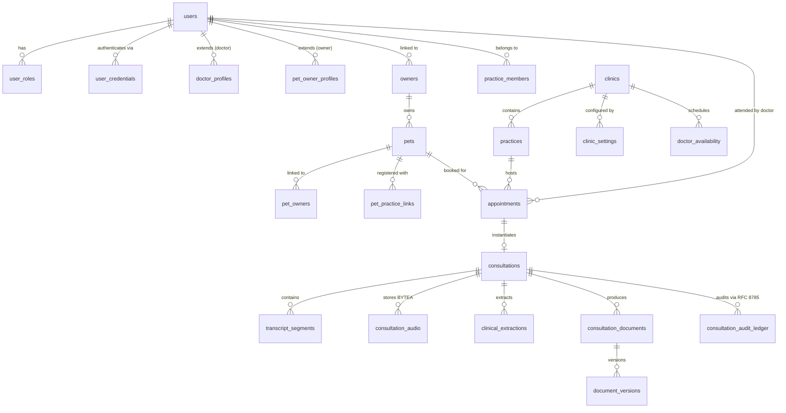
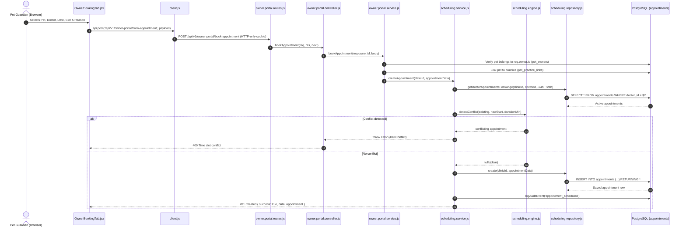
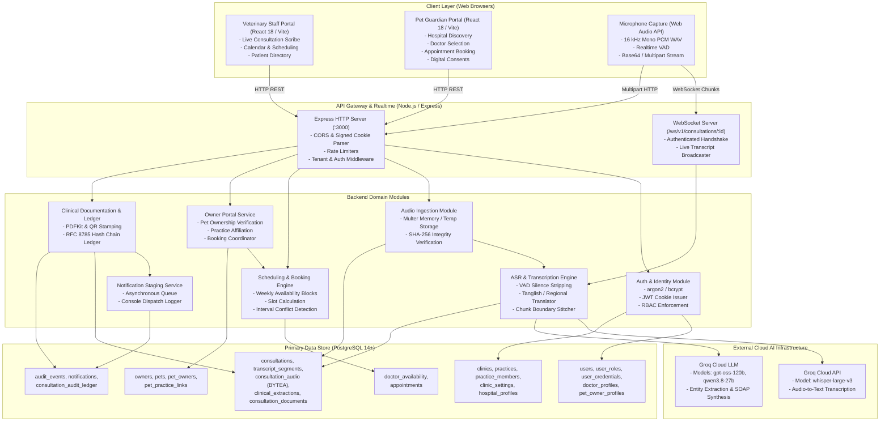

# Current System Architecture Specification: PetCare AI / VetScribe

> **Document Version:** 1.0.0  
> **Target Audience:** Engineering Team, System Architects, Technical Leadership  
> **Primary Purpose:** Comprehensive baseline architectural analysis to guide the integration of the Voice-Based Appointment Booking feature.  
> **Auditing Paradigm:** Strictly evidence-based, read-only code inspection. Where requested items do not exist in the codebase, they are explicitly designated as **NOT FOUND**.

---

## 1. Tech Stack & Dependencies

### 1.1 Android Application (APK)
* **Status:** **NOT FOUND**
* **Evidence:** An exhaustive recursive scan of the repository was conducted for Android build artifacts, manifest files, and native source code (`*manifest*`, `*.gradle*`, `*.kt`, `*.java`, `android/`, `app/`). The only matches found were metadata manifests inside `graphify-out/manifest.json` and `tests/asr-audit/manifest.json`. No Android native project, APK binary, Gradle wrapper, or Kotlin/Java source files exist in this repository.
* **Client Architecture Note:** The existing client is exclusively a Web Single Page Application (SPA) accessible across desktop and mobile browser viewports.

### 1.2 Web Client (Frontend SPA)
* **Evidence File:** [frontend/package.json](file:///c:/Users/Athavan/Desktop/Voice%20to%20transcript/frontend/package.json)
* **Language & Runtime:** JavaScript (ES Modules, JSX)
* **Framework:** React `^18.3.1`, React DOM `^18.3.1`
* **Build Tool & Dev Server:** Vite `^6.1.0` (`@vitejs/plugin-react` `^4.3.4`)
* **Iconography:** Lucide React `^0.475.0`
* **Testing Framework:** Playwright `^1.65.0` (`@playwright/test`)
* **Styling & Design Tokens:** Vanilla CSS with a centralized token architecture in [frontend/src/styles/theme.css](file:///c:/Users/Athavan/Desktop/Voice%20to%20transcript/frontend/src/styles/theme.css) and reusable UI classes in [frontend/src/styles/components.css](file:///c:/Users/Athavan/Desktop/Voice%20to%20transcript/frontend/src/styles/components.css). No CSS-in-JS or Tailwind CSS libraries are used.

### 1.3 Backend Service
* **Evidence File:** [backend/package.json](file:///c:/Users/Athavan/Desktop/Voice%20to%20transcript/backend/package.json)
* **Language & Runtime:** Node.js (CommonJS, `node >= 18.0.0`)
* **Web Framework:** Express `^4.21.2`
* **Database Driver:** `pg` `^8.13.1` (node-postgres connection pool, parameterized raw SQL; no ORM)
* **Real-Time Communication:** `ws` `^8.18.0` (native WebSocket protocol server bound to the Node.js HTTP server)
* **Authentication & Cryptography:**
  * Password Hashing: `argon2` `^0.45.2`, `bcryptjs` `^3.0.3`
  * Token Generation & Verification: `jsonwebtoken` `^9.0.3`
  * Cookie Handling: `cookie-parser` `^1.4.7`
* **Traffic & Rate Limiting:** `express-rate-limit` `^8.7.4`
* **Audio & File Ingestion:** `multer` `^2.5.0` (both memory storage for zero-disk direct database persistence and temp disk storage)
* **AI & Language Processing:**
  * `openai` `^7.52.0` (configured to interface with Groq Cloud's OpenAI-compatible inference endpoint for Whisper Large V3 and LLM completion models, with fallback to OpenAI)
* **Schema Validation:** `zod` `^3.24.1`
* **Document & Image Generation:**
  * `pdfkit` `^0.20.2` (clinical prescription and SOAP note PDF generation)
  * `qrcode` `^1.5.4` (tamper-evident QR code generation for digital prescription verification)
* **Environment Configuration:** `dotenv` `^16.4.7`

---

## 2. Project Structure & Module Organization

```
Voice to transcript/
├── CURRENT_ARCHITECTURE.md                # This architectural specification document
├── UI_GUIDELINES.md                       # Design token rules, mobile-first CSS standards
├── AGENTS.md                              # AI agent working agreements and safe editing guidelines
├── package.json                           # Root scripts and workspace orchestrator
│
├── backend/                               # Express + Node.js REST API & WebSocket Server
│   ├── package.json                       # Backend dependencies and scripts
│   ├── src/
│   │   ├── server.js                      # Application entry point, HTTP + WebSocket initialization
│   │   ├── config/
│   │   │   └── index.js                   # Centralized environment variable loader and defaults
│   │   ├── db/
│   │   │   ├── index.js                   # PostgreSQL pg.Pool connection lifecycle manager
│   │   │   ├── schema.sql                 # Baseline database schema definition
│   │   │   ├── migrate.js                 # Sequential database migration runner
│   │   │   └── migrations/                # Migration scripts (001 to 010)
│   │   ├── middleware/
│   │   │   ├── authenticate.js            # JWT verification & healthcare staff context
│   │   │   ├── ownerAuthenticate.js       # Pet guardian/customer JWT verification & owner record resolution
│   │   │   ├── authorize.js               # Role-Based Access Control (RBAC) guard
│   │   │   ├── tenantContext.js           # Multi-tenant clinic context extractor (X-Clinic-ID / JWT)
│   │   │   └── rateLimiters.js            # IP and route-based rate limiters for auth flows
│   │   ├── modules/                       # Domain-driven backend modules:
│   │   │   ├── audit-viewer/              # Cryptographic audit ledger query, export, and verification
│   │   │   ├── audio/                     # Audio ingestion (multer), temp storage, BYTEA streaming, hash checks
│   │   │   ├── auth/                      # Staff/doctor/hospital registration, login, OTP, MFA, token refresh
│   │   │   ├── clinic-settings/           # Clinic operational preferences, audio retention policies, timezone
│   │   │   ├── clinical-ai/               # LLM clinical extraction, SOAP note synthesis, Zod schemas
│   │   │   ├── consultations/             # Consultation lifecycle state machine (start, pause, complete)
│   │   │   ├── directory/                 # Doctor, patient, and consultation administrative directory
│   │   │   ├── documents/                 # Medical document approvals, PDFKit compilation, QR stamping
│   │   │   ├── invitations/               # Hospital staff invitations and token verification
│   │   │   ├── notifications/             # Notification dispatch queue & email console staging service
│   │   │   ├── owner-portal/              # Pet owner authentication, pet management, slot lookup, booking
│   │   │   ├── owners/                    # Hospital staff management of customer/owner records
│   │   │   ├── pets/                      # Hospital staff management of patient/pet records
│   │   │   ├── practices/                 # Multi-practice discovery, independent practice registration, join requests
│   │   │   ├── realtime/                  # WebSocket server (`ws`), connection registry, live transcript broadcasting
│   │   │   ├── scheduling/                # Scheduling engine, doctor availability, appointment slot conflict detection
│   │   │   ├── staff/                     # Hospital staff onboarding, doctor licensing, role elevation
│   │   │   ├── super-admin/               # Platform control plane, hospital vetting, global analytics
│   │   │   ├── transcription/             # Groq Whisper Large V3 client, VAD silence filtering, translation
│   │   │   └── verify/                    # Public tamper-evident cryptographic QR verification endpoint
│   │   └── uploads/                       # Local directory for generated PDFs and temporary files
│   └── tests/                             # Node.js native test runner test suites
│
├── frontend/                              # React 18 + Vite Web Application
│   ├── package.json                       # Frontend dependencies and test scripts
│   ├── vite.config.js                     # Vite build configuration, proxy rules
│   ├── index.html                         # Single-page HTML shell with viewport and font headers
│   └── src/
│       ├── main.jsx                       # React DOM root bootstrapping
│       ├── App.jsx                        # Primary view router, role shell, and layout switchboard
│       ├── api/
│       │   └── client.js                  # Centralized HTTP fetch wrapper (`credentials: 'include'`)
│       ├── context/
│       │   └── AuthContext.jsx            # Authentication state, active practice, user profile, RBAC switcher
│       ├── features/
│       │   ├── admin/                     # Staff, clinic settings, and platform administrative dashboards
│       │   ├── audit/                     # Cryptographic audit ledger viewer and CSV export UI
│       │   ├── auth/                      # Staff login, registration, and OTP verification modals
│       │   ├── consultation/              # Live consultation ambient scribe UI, audio recording, WebSocket hooks
│       │   ├── directory/                 # Hospital patient, owner, and doctor directory table views
│       │   ├── owner/                     # Pet Guardian Portal: OwnerBookingTab, OwnerAppointmentDualTab, pets, records
│       │   └── scheduling/                # Doctor calendar, time-slot picker, daily consultation queue
│       └── styles/
│           ├── theme.css                  # Master CSS custom properties (colors, typography, spacing, radius)
│           ├── components.css             # Reusable design system classes (buttons, cards, badges, inputs)
│           └── index.css                  # Base resets and typography defaults
│
└── tests/                                 # End-to-end and responsive integration tests (Playwright)
```

---

## 3. App Architecture (Client-Side)

### 3.1 Android Mobile Architecture
* **Status:** **NOT FOUND**
* **Pattern, Navigation, DI, Networking, Storage:** No Android Native code exists. There are no Kotlin or Java classes implementing MVVM, MVI, or MVC, no Jetpack Navigation, no Dagger/Hilt/Koin dependency injection, no Retrofit/OkHttp networking libraries, and no Room/SharedPreferences storage engines.

### 3.2 Web Frontend Architecture (Actual Client Implementation)
* **Architectural Pattern:** Component-based Feature-Driven Architecture built on React 18.
* **Navigation & View Routing:**
  * **Evidence File:** [frontend/src/App.jsx](file:///c:/Users/Athavan/Desktop/Voice%20to%20transcript/frontend/src/App.jsx#L40-L120)
  * The application does not use external routing libraries (like `react-router-dom`). Navigation is state-driven via the `currentView` string state in `App.jsx`.
  * Views include: `'consultation'`, `'directory'`, `'admin'`, `'scheduling'`, `'clinic-settings'`, `'audit-viewer'`, `'owner-portal'`, `'login'`.
  * Mobile navigation utilizes a persistent bottom tab bar (`.mobile-bottom-nav`) adhering to minimum touch target rules (`44px` / `var(--touch-target)`).
* **Dependency Injection & Global State:**
  * **Evidence File:** [frontend/src/context/AuthContext.jsx](file:///c:/Users/Athavan/Desktop/Voice%20to%20transcript/frontend/src/context/AuthContext.jsx)
  * React Context API is used for dependency injection and state sharing across components.
  * `AuthContext` provides: `user`, `role`, `clinicId`, `activePractice`, `login()`, `logout()`, `switchPractice()`, and authentication status.
* **Networking Library:**
  * **Evidence File:** [frontend/src/api/client.js](file:///c:/Users/Athavan/Desktop/Voice%20to%20transcript/frontend/src/api/client.js)
  * Built around the browser's native `fetch` API.
  * Every request automatically includes `credentials: 'include'` to transmit signed HTTP-only session cookies.
  * Dynamically attaches the `X-Clinic-ID` tenant header from `localStorage.getItem('active_clinic_id')`.
  * Provides structured JSON parsing, automatic token refresh intercepts, and unified error propagation.
* **Local Storage & Persistence:**
  * Browser `localStorage`: Used for client-side user session cache (`user`), active practice selector (`active_practice`), UI theme (`theme: 'light' | 'dark'`), and active navigation tabs (`active_tab`).
  * Browser Cookies: HTTP-only signed cookies (`petcare_access_token`, `petcare_refresh_token`) maintained and set by the server.
* **State Management:**
  * Local component state managed via React hooks: `useState`, `useReducer`, `useEffect`, `useCallback`, `useMemo`.
  * Custom Domain Hooks:
    * [useMicrophone.js](file:///c:/Users/Athavan/Desktop/Voice%20to%20transcript/frontend/src/features/consultation/hooks/useMicrophone.js): Captures live browser audio via Web Audio API, handles 16kHz mono PCM conversion, VAD silence management, and chunking.
    * [useConsultationWebSocket.js](file:///c:/Users/Athavan/Desktop/Voice%20to%20transcript/frontend/src/features/consultation/hooks/useConsultationWebSocket.js): Manages WebSocket lifecycle, reconnects with exponential backoff, and listens for live transcript segments.
    * [useConsultationState.js](file:///c:/Users/Athavan/Desktop/Voice%20to%20transcript/frontend/src/features/consultation/hooks/useConsultationState.js): Orchestrates consultation state machine transitions and clinical document drafts.

---

## 4. Backend Architecture

### 4.1 Framework & Server Entry Point
* **Framework:** Express.js `^4.21.2` running on Node.js HTTP server.
* **Entry Point:** [backend/src/server.js](file:///c:/Users/Athavan/Desktop/Voice%20to%20transcript/backend/src/server.js)
  * Initializes the Express app.
  * Binds CORS, cookie parser, JSON/URL-encoded body parsers, and HTTP request logging.
  * Mounts 17 domain router modules under `/api/v1/*`.
  * Binds the WebSocket server via `setupWebSocketServer(server)` ([backend/src/modules/realtime/ws.server.js](file:///c:/Users/Athavan/Desktop/Voice%20to%20transcript/backend/src/modules/realtime/ws.server.js)).
  * Catches unhandled routes with a global 404 handler.
  * Formats unhandled exceptions with a global error handler (`err.statusCode || 500`).

### 4.2 Middleware Pipeline
1. **CORS:** [backend/src/server.js](file:///c:/Users/Athavan/Desktop/Voice%20to%20transcript/backend/src/server.js#L33-L42) — Allows localhost/127.0.0.1 ports and configured frontend origins with `credentials: true`.
2. **Cookie Parser:** [backend/src/server.js](file:///c:/Users/Athavan/Desktop/Voice%20to%20transcript/backend/src/server.js#L44) — Signed cookie parsing using `config.auth.cookieSecret`.
3. **Body Parsers:** `express.json({ limit: '10mb' })` and `express.urlencoded({ extended: true })`.
4. **Rate Limiters:** [backend/src/middleware/rateLimiters.js](file:///c:/Users/Athavan/Desktop/Voice%20to%20transcript/backend/src/middleware/rateLimiters.js)
   * `authLoginLimiter`: 5 attempts per 15 minutes.
   * `authRegisterLimiter`: 5 registrations per hour.
   * `authVerificationLimiter`: 10 verification/resend requests per 15 minutes.
   * `authResetLimiter`: 3 password reset requests per hour.
   * `authRefreshLimiter`: 60 token refresh calls per 15 minutes.
5. **Authentication (`authenticate`):** [backend/src/middleware/authenticate.js](file:///c:/Users/Athavan/Desktop/Voice%20to%20transcript/backend/src/middleware/authenticate.js#L14) — Validates JWT from cookie or Bearer header; verifies user existence and status in `users`; loads assigned roles from `user_roles`.
6. **Owner Authentication (`ownerAuthenticate`):** [backend/src/middleware/ownerAuthenticate.js](file:///c:/Users/Athavan/Desktop/Voice%20to%20transcript/backend/src/middleware/ownerAuthenticate.js#L11) — Specific to pet guardians; decodes JWT, queries `owners` table (`WHERE user_id = $1`), and attaches `req.owner = { id, clinicId, name, phone, email, userId }`.
7. **Authorization (`authorize`):** [backend/src/middleware/authorize.js](file:///c:/Users/Athavan/Desktop/Voice%20to%20transcript/backend/src/middleware/authorize.js#L7) — RBAC middleware checking if `req.user.roles` or `req.user.role` matches allowed roles (e.g., `['clinic_admin', 'super_admin', 'doctor']`).
8. **Tenant Context (`tenantContext`):** [backend/src/middleware/tenantContext.js](file:///c:/Users/Athavan/Desktop/Voice%20to%20transcript/backend/src/middleware/tenantContext.js#L13) — Ensures data isolation by resolving `clinicId` from `X-Clinic-ID` header or JWT token claims. Validates clinic existence and status in `clinics`.

### 4.3 Validation Strategy
* **Zod Schemas:**
  * Auth validation in [backend/src/modules/auth/auth.controller.js](file:///c:/Users/Athavan/Desktop/Voice%20to%20transcript/backend/src/modules/auth/auth.controller.js#L1-L35) parses and validates registration and login payloads.
  * Structured clinical AI extraction in [backend/src/modules/clinical-ai/clinical.schemas.js](file:///c:/Users/Athavan/Desktop/Voice%20to%20transcript/backend/src/modules/clinical-ai/clinical.schemas.js) strictly validates LLM JSON extractions (diagnoses, prescriptions, labs, follow-ups).
* **Imperative Validation:** Controllers and services across scheduling, owner-portal, and consultations perform imperative parameter validation (e.g., verifying date formats, checking parameter presence, throwing explicit `Error` with `statusCode = 400`).

### 4.4 Comprehensive Route Catalog

| Module | Method | Full Path | Auth / Guard | Purpose | Evidence File |
| :--- | :--- | :--- | :--- | :--- | :--- |
| **System** | `GET` | `/health` | Public | Service health & timestamp | [server.js](file:///c:/Users/Athavan/Desktop/Voice%20to%20transcript/backend/src/server.js#L57) |
| **Auth** | `POST` | `/api/v1/auth/register-clinic` | Rate-limited | Legacy clinic + admin registration | [auth.routes.js](file:///c:/Users/Athavan/Desktop/Voice%20to%20transcript/backend/src/modules/auth/auth.routes.js#L14) |
| **Auth** | `POST` | `/api/v1/auth/register/hospital` | Rate-limited | Independent hospital self-registration | [auth.routes.js](file:///c:/Users/Athavan/Desktop/Voice%20to%20transcript/backend/src/modules/auth/auth.routes.js#L17) |
| **Auth** | `POST` | `/api/v1/auth/register/doctor` | Rate-limited | Independent doctor self-registration | [auth.routes.js](file:///c:/Users/Athavan/Desktop/Voice%20to%20transcript/backend/src/modules/auth/auth.routes.js#L18) |
| **Auth** | `POST` | `/api/v1/auth/register/pet-owner` | Rate-limited | Independent pet guardian registration | [auth.routes.js](file:///c:/Users/Athavan/Desktop/Voice%20to%20transcript/backend/src/modules/auth/auth.routes.js#L19) |
| **Auth** | `POST` | `/api/v1/auth/verify-email` | Rate-limited | Verify email OTP code | [auth.routes.js](file:///c:/Users/Athavan/Desktop/Voice%20to%20transcript/backend/src/modules/auth/auth.routes.js#L22) |
| **Auth** | `POST` | `/api/v1/auth/verify-mobile` | Rate-limited | Verify mobile SMS OTP code | [auth.routes.js](file:///c:/Users/Athavan/Desktop/Voice%20to%20transcript/backend/src/modules/auth/auth.routes.js#L23) |
| **Auth** | `POST` | `/api/v1/auth/resend-verification`| Rate-limited | Resend verification OTP code | [auth.routes.js](file:///c:/Users/Athavan/Desktop/Voice%20to%20transcript/backend/src/modules/auth/auth.routes.js#L24) |
| **Auth** | `POST` | `/api/v1/auth/forgot-password` | Rate-limited | Request password reset token | [auth.routes.js](file:///c:/Users/Athavan/Desktop/Voice%20to%20transcript/backend/src/modules/auth/auth.routes.js#L25) |
| **Auth** | `POST` | `/api/v1/auth/reset-password` | Rate-limited | Complete password reset via token | [auth.routes.js](file:///c:/Users/Athavan/Desktop/Voice%20to%20transcript/backend/src/modules/auth/auth.routes.js#L26) |
| **Auth** | `POST` | `/api/v1/auth/login` | Rate-limited | Authenticate with credentials; issue JWT cookies | [auth.routes.js](file:///c:/Users/Athavan/Desktop/Voice%20to%20transcript/backend/src/modules/auth/auth.routes.js#L29) |
| **Auth** | `POST` | `/api/v1/auth/mfa/verify` | Rate-limited | Verify TOTP MFA code | [auth.routes.js](file:///c:/Users/Athavan/Desktop/Voice%20to%20transcript/backend/src/modules/auth/auth.routes.js#L30) |
| **Auth** | `POST` | `/api/v1/auth/refresh` | Rate-limited | Refresh access token via refresh token cookie | [auth.routes.js](file:///c:/Users/Athavan/Desktop/Voice%20to%20transcript/backend/src/modules/auth/auth.routes.js#L31) |
| **Auth** | `POST` | `/api/v1/auth/logout` | Public | Clear auth cookies | [auth.routes.js](file:///c:/Users/Athavan/Desktop/Voice%20to%20transcript/backend/src/modules/auth/auth.routes.js#L32) |
| **Auth** | `POST` | `/api/v1/auth/logout-all` | `authenticate` | Revoke all refresh tokens for current user | [auth.routes.js](file:///c:/Users/Athavan/Desktop/Voice%20to%20transcript/backend/src/modules/auth/auth.routes.js#L35) |
| **Auth** | `POST` | `/api/v1/auth/switch-practice` | `authenticate` | Switch active practice workspace context | [auth.routes.js](file:///c:/Users/Athavan/Desktop/Voice%20to%20transcript/backend/src/modules/auth/auth.routes.js#L36) |
| **Auth** | `GET` | `/api/v1/auth/me` | `authenticate` | Fetch currently authenticated user profile | [auth.routes.js](file:///c:/Users/Athavan/Desktop/Voice%20to%20transcript/backend/src/modules/auth/auth.routes.js#L37) |
| **Owner Auth**| `POST` | `/api/v1/owner-auth/signup` | Public | Quick pet owner registration | [owner.auth.routes.js](file:///c:/Users/Athavan/Desktop/Voice%20to%20transcript/backend/src/modules/owner-portal/owner.auth.routes.js#L5) |
| **Owner Auth**| `POST` | `/api/v1/owner-auth/send-otp` | Public | Send login OTP to customer mobile | [owner.auth.routes.js](file:///c:/Users/Athavan/Desktop/Voice%20to%20transcript/backend/src/modules/owner-portal/owner.auth.routes.js#L6) |
| **Owner Auth**| `POST` | `/api/v1/owner-auth/verify-otp`| Public | Verify OTP and authenticate pet owner | [owner.auth.routes.js](file:///c:/Users/Athavan/Desktop/Voice%20to%20transcript/backend/src/modules/owner-portal/owner.auth.routes.js#L7) |
| **Owner Auth**| `POST` | `/api/v1/owner-auth/logout` | Public | Clear pet owner session cookie | [owner.auth.routes.js](file:///c:/Users/Athavan/Desktop/Voice%20to%20transcript/backend/src/modules/owner-portal/owner.auth.routes.js#L8) |
| **Owner Portal**| `GET` | `/api/v1/owner-portal/me` | `ownerAuthenticate`| Get guardian profile | [owner.portal.routes.js](file:///c:/Users/Athavan/Desktop/Voice%20to%20transcript/backend/src/modules/owner-portal/owner.portal.routes.js#L10) |
| **Owner Portal**| `PUT` | `/api/v1/owner-portal/me` | `ownerAuthenticate`| Update guardian profile | [owner.portal.routes.js](file:///c:/Users/Athavan/Desktop/Voice%20to%20transcript/backend/src/modules/owner-portal/owner.portal.routes.js#L11) |
| **Owner Portal**| `PUT` | `/api/v1/owner-portal/preferences`| `ownerAuthenticate`| Update notification preferences | [owner.portal.routes.js](file:///c:/Users/Athavan/Desktop/Voice%20to%20transcript/backend/src/modules/owner-portal/owner.portal.routes.js#L12) |
| **Owner Portal**| `GET` | `/api/v1/owner-portal/pets` | `ownerAuthenticate`| List owner's registered pets | [owner.portal.routes.js](file:///c:/Users/Athavan/Desktop/Voice%20to%20transcript/backend/src/modules/owner-portal/owner.portal.routes.js#L15) |
| **Owner Portal**| `POST` | `/api/v1/owner-portal/pets` | `ownerAuthenticate`| Register new pet for owner | [owner.portal.routes.js](file:///c:/Users/Athavan/Desktop/Voice%20to%20transcript/backend/src/modules/owner-portal/owner.portal.routes.js#L16) |
| **Owner Portal**| `PUT` | `/api/v1/owner-portal/pets/:id` | `ownerAuthenticate`| Update registered pet | [owner.portal.routes.js](file:///c:/Users/Athavan/Desktop/Voice%20to%20transcript/backend/src/modules/owner-portal/owner.portal.routes.js#L17) |
| **Owner Portal**| `GET` | `/api/v1/owner-portal/consultations`| `ownerAuthenticate`| View historical consultations | [owner.portal.routes.js](file:///c:/Users/Athavan/Desktop/Voice%20to%20transcript/backend/src/modules/owner-portal/owner.portal.routes.js#L20) |
| **Owner Portal**| `GET` | `/api/v1/owner-portal/prescriptions`| `ownerAuthenticate`| View approved digital prescriptions | [owner.portal.routes.js](file:///c:/Users/Athavan/Desktop/Voice%20to%20transcript/backend/src/modules/owner-portal/owner.portal.routes.js#L21) |
| **Owner Portal**| `GET` | `/api/v1/owner-portal/consent/pending`| `ownerAuthenticate`| Get pending digital consent requests | [owner.portal.routes.js](file:///c:/Users/Athavan/Desktop/Voice%20to%20transcript/backend/src/modules/owner-portal/owner.portal.routes.js#L24) |
| **Owner Portal**| `POST` | `/api/v1/owner-portal/consent/sign`| `ownerAuthenticate`| Sign consultation consent | [owner.portal.routes.js](file:///c:/Users/Athavan/Desktop/Voice%20to%20transcript/backend/src/modules/owner-portal/owner.portal.routes.js#L25) |
| **Owner Portal**| `GET` | `/api/v1/owner-portal/hospitals`| `ownerAuthenticate`| Discover active hospitals & practices | [owner.portal.routes.js](file:///c:/Users/Athavan/Desktop/Voice%20to%20transcript/backend/src/modules/owner-portal/owner.portal.routes.js#L28) |
| **Owner Portal**| `GET` | `/api/v1/owner-portal/hospitals/:clinicId/doctors`| `ownerAuthenticate`| List doctors in selected hospital | [owner.portal.routes.js](file:///c:/Users/Athavan/Desktop/Voice%20to%20transcript/backend/src/modules/owner-portal/owner.portal.routes.js#L29) |
| **Owner Portal**| `POST` | `/api/v1/owner-portal/affiliation`| `ownerAuthenticate`| Affiliate pet owner with hospital | [owner.portal.routes.js](file:///c:/Users/Athavan/Desktop/Voice%20to%20transcript/backend/src/modules/owner-portal/owner.portal.routes.js#L30) |
| **Owner Portal**| `DELETE`| `/api/v1/owner-portal/affiliation`| `ownerAuthenticate`| Remove hospital affiliation | [owner.portal.routes.js](file:///c:/Users/Athavan/Desktop/Voice%20to%20transcript/backend/src/modules/owner-portal/owner.portal.routes.js#L31) |
| **Owner Portal**| `GET` | `/api/v1/owner-portal/available-slots`| `ownerAuthenticate`| Query open appointment slots | [owner.portal.routes.js](file:///c:/Users/Athavan/Desktop/Voice%20to%20transcript/backend/src/modules/owner-portal/owner.portal.routes.js#L34) |
| **Owner Portal**| `GET` | `/api/v1/owner-portal/appointments`| `ownerAuthenticate`| List owner's appointments | [owner.portal.routes.js](file:///c:/Users/Athavan/Desktop/Voice%20to%20transcript/backend/src/modules/owner-portal/owner.portal.routes.js#L35) |
| **Owner Portal**| `POST` | `/api/v1/owner-portal/book-appointment`| `ownerAuthenticate`| Book an appointment for a pet | [owner.portal.routes.js](file:///c:/Users/Athavan/Desktop/Voice%20to%20transcript/backend/src/modules/owner-portal/owner.portal.routes.js#L36) |
| **Assistant (Dharu)**| `POST` | `/api/v1/owner-portal/assistant/turn` | `ownerAuthenticate`, rate-limited | Multi-turn chat/voice booking interaction (accepts JSON or in-memory audio) | [assistant.routes.js](file:///c:/Users/Athavan/Desktop/Voice%20to%20transcript/backend/src/modules/assistant/assistant.routes.js#L21) |
| **Assistant (Dharu)**| `POST` | `/api/v1/owner-portal/assistant/session/:id/cancel` | `ownerAuthenticate` | Cancel active assistant booking session | [assistant.routes.js](file:///c:/Users/Athavan/Desktop/Voice%20to%20transcript/backend/src/modules/assistant/assistant.routes.js#L24) |
| **Assistant (Dharu)**| `GET` | `/api/v1/owner-portal/assistant/push/vapid-key` | `ownerAuthenticate` | Retrieve VAPID public key for Web Push registration | [assistant.routes.js](file:///c:/Users/Athavan/Desktop/Voice%20to%20transcript/backend/src/modules/assistant/assistant.routes.js#L27) |
| **Assistant (Dharu)**| `POST` | `/api/v1/owner-portal/assistant/push/subscribe` | `ownerAuthenticate` | Register browser Web Push notification subscription | [assistant.routes.js](file:///c:/Users/Athavan/Desktop/Voice%20to%20transcript/backend/src/modules/assistant/assistant.routes.js#L28) |
| **Assistant (Dharu)**| `DELETE`| `/api/v1/owner-portal/assistant/push/subscribe` | `ownerAuthenticate` | Unsubscribe device from Web Push notifications | [assistant.routes.js](file:///c:/Users/Athavan/Desktop/Voice%20to%20transcript/backend/src/modules/assistant/assistant.routes.js#L29) |
| **Assistant (Dharu)**| `POST` | `/api/v1/owner-portal/assistant/telegram/link-code` | `ownerAuthenticate` | Generate 6-digit one-time code to link Telegram Bot | [assistant.routes.js](file:///c:/Users/Athavan/Desktop/Voice%20to%20transcript/backend/src/modules/assistant/assistant.routes.js#L32) |
| **Telegram Bot** | `POST` | `/api/v1/telegram/webhook` | Public (Telegram IP) | Inbound Telegram webhook for chat messages and inline keyboard callback queries | [server.js](file:///c:/Users/Athavan/Desktop/Voice%20to%20transcript/backend/src/server.js#L77) |
| **Scheduling** | `GET` | `/api/v1/scheduling` | `auth`, `tenant` | List practice appointments | [scheduling.routes.js](file:///c:/Users/Athavan/Desktop/Voice%20to%20transcript/backend/src/modules/scheduling/scheduling.routes.js#L6) |
| **Scheduling** | `GET` | `/api/v1/scheduling/today-queue`| `auth`, `tenant` | Get doctor's today queue | [scheduling.routes.js](file:///c:/Users/Athavan/Desktop/Voice%20to%20transcript/backend/src/modules/scheduling/scheduling.routes.js#L7) |
| **Scheduling** | `GET` | `/api/v1/scheduling/slots` | `auth`, `tenant` | Compute available doctor time slots | [scheduling.routes.js](file:///c:/Users/Athavan/Desktop/Voice%20to%20transcript/backend/src/modules/scheduling/scheduling.routes.js#L8) |
| **Scheduling** | `GET` | `/api/v1/scheduling/availability/:doctorId`| `auth`, `tenant`| Get recurring weekly schedule | [scheduling.routes.js](file:///c:/Users/Athavan/Desktop/Voice%20to%20transcript/backend/src/modules/scheduling/scheduling.routes.js#L9) |
| **Scheduling** | `PUT` | `/api/v1/scheduling/availability/:doctorId`| `auth`, `tenant`, `admin/doc`| Update doctor's weekly availability | [scheduling.routes.js](file:///c:/Users/Athavan/Desktop/Voice%20to%20transcript/backend/src/modules/scheduling/scheduling.routes.js#L10) |
| **Scheduling** | `GET` | `/api/v1/scheduling/:id` | `auth`, `tenant` | Get appointment details | [scheduling.routes.js](file:///c:/Users/Athavan/Desktop/Voice%20to%20transcript/backend/src/modules/scheduling/scheduling.routes.js#L11) |
| **Scheduling** | `POST` | `/api/v1/scheduling` | `auth`, `tenant` | Create staff-booked appointment | [scheduling.routes.js](file:///c:/Users/Athavan/Desktop/Voice%20to%20transcript/backend/src/modules/scheduling/scheduling.routes.js#L12) |
| **Scheduling** | `PATCH` | `/api/v1/scheduling/:id` | `auth`, `tenant` | Update/reschedule/cancel appointment | [scheduling.routes.js](file:///c:/Users/Athavan/Desktop/Voice%20to%20transcript/backend/src/modules/scheduling/scheduling.routes.js#L13) |
| **Practices** | `GET` | `/api/v1/practices/discover`| Public | Directory of active practices | [practice.routes.js](file:///c:/Users/Athavan/Desktop/Voice%20to%20transcript/backend/src/modules/practices/practice.routes.js#L7) |
| **Practices** | `GET` | `/api/v1/practices/my-invitations`| `authenticate` | Doctor's pending hospital invitations| [practice.routes.js](file:///c:/Users/Athavan/Desktop/Voice%20to%20transcript/backend/src/modules/practices/practice.routes.js#L10) |
| **Practices** | `POST` | `/api/v1/practices/invitations/:inviteId/respond`| `authenticate`| Accept/reject hospital invitation | [practice.routes.js](file:///c:/Users/Athavan/Desktop/Voice%20to%20transcript/backend/src/modules/practices/practice.routes.js#L11) |
| **Practices** | `GET` | `/api/v1/practices/my-join-requests`| `authenticate`| Doctor's submitted join requests | [practice.routes.js](file:///c:/Users/Athavan/Desktop/Voice%20to%20transcript/backend/src/modules/practices/practice.routes.js#L12) |
| **Practices** | `POST` | `/api/v1/practices` | `authenticate` | Create independent practice workspace| [practice.routes.js](file:///c:/Users/Athavan/Desktop/Voice%20to%20transcript/backend/src/modules/practices/practice.routes.js#L15) |
| **Practices** | `GET` | `/api/v1/practices/:id` | Optional Auth | Practice details | [practice.routes.js](file:///c:/Users/Athavan/Desktop/Voice%20to%20transcript/backend/src/modules/practices/practice.routes.js#L18) |
| **Practices** | `POST` | `/api/v1/practices/:id/invitations`| `authenticate` | Invite doctor to hospital | [practice.routes.js](file:///c:/Users/Athavan/Desktop/Voice%20to%20transcript/backend/src/modules/practices/practice.routes.js#L19) |
| **Practices** | `POST` | `/api/v1/practices/:id/join-requests`| `authenticate` | Doctor requests to join hospital | [practice.routes.js](file:///c:/Users/Athavan/Desktop/Voice%20to%20transcript/backend/src/modules/practices/practice.routes.js#L20) |
| **Practices** | `GET` | `/api/v1/practices/:id/join-requests`| `authenticate` | List pending join requests for practice| [practice.routes.js](file:///c:/Users/Athavan/Desktop/Voice%20to%20transcript/backend/src/modules/practices/practice.routes.js#L21) |
| **Practices** | `PATCH` | `/api/v1/practices/:id/join-requests/:requestId/approve`| `authenticate`| Hospital admin approves doctor | [practice.routes.js](file:///c:/Users/Athavan/Desktop/Voice%20to%20transcript/backend/src/modules/practices/practice.routes.js#L22) |
| **Practices** | `PATCH` | `/api/v1/practices/:id/join-requests/:requestId/reject`| `authenticate` | Hospital admin rejects doctor | [practice.routes.js](file:///c:/Users/Athavan/Desktop/Voice%20to%20transcript/backend/src/modules/practices/practice.routes.js#L23) |
| **Consultations**| `GET` | `/api/v1/consultations`| `auth`, `tenant` | List tenant consultations | [consultation.routes.js](file:///c:/Users/Athavan/Desktop/Voice%20to%20transcript/backend/src/modules/consultations/consultation.routes.js#L6) |
| **Consultations**| `GET` | `/api/v1/consultations/meta/pets`| `auth`, `tenant`| Get pet list for consultation selector | [consultation.routes.js](file:///c:/Users/Athavan/Desktop/Voice%20to%20transcript/backend/src/modules/consultations/consultation.routes.js#L7) |
| **Consultations**| `POST` | `/api/v1/consultations`| `auth`, `tenant` | Create new clinical consultation | [consultation.routes.js](file:///c:/Users/Athavan/Desktop/Voice%20to%20transcript/backend/src/modules/consultations/consultation.routes.js#L8) |
| **Consultations**| `GET` | `/api/v1/consultations/:id`| `auth`, `tenant` | Fetch consultation by ID | [consultation.routes.js](file:///c:/Users/Athavan/Desktop/Voice%20to%20transcript/backend/src/modules/consultations/consultation.routes.js#L9) |
| **Consultations**| `PATCH` | `/api/v1/consultations/:id/doctor`| `auth`, `tenant`| Reassign attending veterinarian | [consultation.routes.js](file:///c:/Users/Athavan/Desktop/Voice%20to%20transcript/backend/src/modules/consultations/consultation.routes.js#L10) |
| **Consultations**| `POST` | `/api/v1/consultations/:id/reset`| `auth`, `tenant` | Reset consultation state and audio | [consultation.routes.js](file:///c:/Users/Athavan/Desktop/Voice%20to%20transcript/backend/src/modules/consultations/consultation.routes.js#L11) |
| **Consultations**| `POST` | `/api/v1/consultations/:id/consent`| `auth`, `tenant`| Record recording consent | [consultation.routes.js](file:///c:/Users/Athavan/Desktop/Voice%20to%20transcript/backend/src/modules/consultations/consultation.routes.js#L12) |
| **Consultations**| `POST` | `/api/v1/consultations/:id/start`| `auth`, `tenant` | Start consultation recording session | [consultation.routes.js](file:///c:/Users/Athavan/Desktop/Voice%20to%20transcript/backend/src/modules/consultations/consultation.routes.js#L13) |
| **Consultations**| `POST` | `/api/v1/consultations/:id/pause`| `auth`, `tenant` | Pause consultation recording | [consultation.routes.js](file:///c:/Users/Athavan/Desktop/Voice%20to%20transcript/backend/src/modules/consultations/consultation.routes.js#L14) |
| **Consultations**| `POST` | `/api/v1/consultations/:id/resume`| `auth`, `tenant`| Resume consultation recording | [consultation.routes.js](file:///c:/Users/Athavan/Desktop/Voice%20to%20transcript/backend/src/modules/consultations/consultation.routes.js#L15) |
| **Consultations**| `POST` | `/api/v1/consultations/:id/stop`| `auth`, `tenant` | Stop consultation recording | [consultation.routes.js](file:///c:/Users/Athavan/Desktop/Voice%20to%20transcript/backend/src/modules/consultations/consultation.routes.js#L16) |
| **Consultations**| `POST` | `/api/v1/consultations/:id/complete`| `auth`, `tenant`| Finalize consultation | [consultation.routes.js](file:///c:/Users/Athavan/Desktop/Voice%20to%20transcript/backend/src/modules/consultations/consultation.routes.js#L17) |
| **Consultations**| `GET` | `/api/v1/consultations/:id/transcript`| `auth`, `tenant`| Get ordered transcript segments | [consultation.routes.js](file:///c:/Users/Athavan/Desktop/Voice%20to%20transcript/backend/src/modules/consultations/consultation.routes.js#L18) |
| **Consultations**| `GET` | `/api/v1/consultations/:id/audit`| `auth`, `tenant` | Get cryptographic audit trail | [consultation.routes.js](file:///c:/Users/Athavan/Desktop/Voice%20to%20transcript/backend/src/modules/consultations/consultation.routes.js#L19) |
| **Audio / ASR**| `POST` | `/api/v1/consultations/:id/audio-chunk`| `auth`, `tenant`| Ingest audio chunk (Multer disk) & run Whisper | [audio.routes.js](file:///c:/Users/Athavan/Desktop/Voice%20to%20transcript/backend/src/modules/audio/audio.routes.js#L101) |
| **Audio / ASR**| `POST` | `/api/v1/consultations/upload-and-scribe`| `auth`, `tenant`| Zero-disk multipart audio ingest + ASR + SOAP | [audio.routes.js](file:///c:/Users/Athavan/Desktop/Voice%20to%20transcript/backend/src/modules/audio/audio.routes.js#L118) |
| **Audio / ASR**| `POST` | `/api/v1/consultations/:id/upload-and-scribe`| `auth`, `tenant`| Scoped multipart audio ingest + ASR + SOAP | [audio.routes.js](file:///c:/Users/Athavan/Desktop/Voice%20to%20transcript/backend/src/modules/audio/audio.routes.js#L124) |
| **Audio / ASR**| `GET` | `/api/v1/consultations/:id/audio`| `auth`, `tenant` | Stream audio BYTEA from database | [audio.routes.js](file:///c:/Users/Athavan/Desktop/Voice%20to%20transcript/backend/src/modules/audio/audio.routes.js#L135) |
| **Audio / ASR**| `GET` | `/api/v1/consultations/:id/audio/verify`| `auth`, `tenant`| Verify stored audio SHA-256 integrity hash | [audio.routes.js](file:///c:/Users/Athavan/Desktop/Voice%20to%20transcript/backend/src/modules/audio/audio.routes.js#L145) |
| **Documents** | `GET` | `/api/v1/documents/:id` | `auth`, `tenant` | Get document with current version | [document.routes.js](file:///c:/Users/Athavan/Desktop/Voice%20to%20transcript/backend/src/modules/documents/document.routes.js#L5) |
| **Documents** | `PATCH` | `/api/v1/documents/:id` | `auth`, `tenant` | Update document content (new version) | [document.routes.js](file:///c:/Users/Athavan/Desktop/Voice%20to%20transcript/backend/src/modules/documents/document.routes.js#L6) |
| **Documents** | `POST` | `/api/v1/documents/:id/approve` | `auth`, `tenant` | Doctor signs and approves document | [document.routes.js](file:///c:/Users/Athavan/Desktop/Voice%20to%20transcript/backend/src/modules/documents/document.routes.js#L7) |
| **Documents** | `POST` | `/api/v1/documents/:id/reject` | `auth`, `tenant` | Doctor rejects document draft | [document.routes.js](file:///c:/Users/Athavan/Desktop/Voice%20to%20transcript/backend/src/modules/documents/document.routes.js#L8) |
| **Documents** | `GET` | `/api/v1/documents/:id/versions`| `auth`, `tenant` | Get version history | [document.routes.js](file:///c:/Users/Athavan/Desktop/Voice%20to%20transcript/backend/src/modules/documents/document.routes.js#L9) |
| **Documents** | `POST` | `/api/v1/documents/:id/pdf` | `auth`, `tenant` | Generate PDF with QR code & ledger hash | [document.routes.js](file:///c:/Users/Athavan/Desktop/Voice%20to%20transcript/backend/src/modules/documents/document.routes.js#L10) |
| **Documents** | `GET` | `/api/v1/documents/:id/download-pdf`| `auth`, `tenant`| Download generated PDF document | [document.routes.js](file:///c:/Users/Athavan/Desktop/Voice%20to%20transcript/backend/src/modules/documents/document.routes.js#L11) |
| **Documents** | `POST` | `/api/v1/documents/:id/send-to-owner`| `auth`, `tenant`| Queue notification email to pet guardian | [document.routes.js](file:///c:/Users/Athavan/Desktop/Voice%20to%20transcript/backend/src/modules/documents/document.routes.js#L12) |
| **Staff** | `GET` | `/api/v1/staff` | `auth`, `tenant`, Admin| List hospital staff members | [staff.routes.js](file:///c:/Users/Athavan/Desktop/Voice%20to%20transcript/backend/src/modules/staff/staff.routes.js#L9) |
| **Staff** | `GET` | `/api/v1/staff/:id/patients` | `auth`, `tenant`, Admin| List patients seen by a specific doctor | [staff.routes.js](file:///c:/Users/Athavan/Desktop/Voice%20to%20transcript/backend/src/modules/staff/staff.routes.js#L10) |
| **Staff** | `POST` | `/api/v1/staff/onboard` | `auth`, `tenant`, Admin| Onboard new doctor or assistant | [staff.routes.js](file:///c:/Users/Athavan/Desktop/Voice%20to%20transcript/backend/src/modules/staff/staff.routes.js#L11) |
| **Staff** | `PATCH` | `/api/v1/staff/:id/role` | `auth`, `tenant`, Admin| Modify user role | [staff.routes.js](file:///c:/Users/Athavan/Desktop/Voice%20to%20transcript/backend/src/modules/staff/staff.routes.js#L12) |
| **Staff** | `POST` | `/api/v1/staff/:id/deactivate` | `auth`, `tenant`, Admin| Deactivate staff user account | [staff.routes.js](file:///c:/Users/Athavan/Desktop/Voice%20to%20transcript/backend/src/modules/staff/staff.routes.js#L13) |
| **Staff** | `POST` | `/api/v1/staff/:id/reactivate` | `auth`, `tenant`, Admin| Reactivate staff user account | [staff.routes.js](file:///c:/Users/Athavan/Desktop/Voice%20to%20transcript/backend/src/modules/staff/staff.routes.js#L14) |
| **Staff** | `PATCH` | `/api/v1/staff/:id/approve-license`| `auth`, `tenant`, Admin| Verify and approve doctor's medical license | [staff.routes.js](file:///c:/Users/Athavan/Desktop/Voice%20to%20transcript/backend/src/modules/staff/staff.routes.js#L15) |
| **Owners** | `GET` | `/api/v1/owners` | `auth`, `tenant` | List practice pet owners | [owner.routes.js](file:///c:/Users/Athavan/Desktop/Voice%20to%20transcript/backend/src/modules/owners/owner.routes.js#L6) |
| **Owners** | `GET` | `/api/v1/owners/:id` | `auth`, `tenant` | Get owner profile and pet relationships | [owner.routes.js](file:///c:/Users/Athavan/Desktop/Voice%20to%20transcript/backend/src/modules/owners/owner.routes.js#L7) |
| **Owners** | `POST` | `/api/v1/owners` | `auth`, `tenant` | Create owner record | [owner.routes.js](file:///c:/Users/Athavan/Desktop/Voice%20to%20transcript/backend/src/modules/owners/owner.routes.js#L8) |
| **Owners** | `PATCH` | `/api/v1/owners/:id` | `auth`, `tenant` | Update owner record | [owner.routes.js](file:///c:/Users/Athavan/Desktop/Voice%20to%20transcript/backend/src/modules/owners/owner.routes.js#L9) |
| **Owners** | `POST` | `/api/v1/owners/merge` | `auth`, `tenant`, Admin| Merge duplicate owner records | [owner.routes.js](file:///c:/Users/Athavan/Desktop/Voice%20to%20transcript/backend/src/modules/owners/owner.routes.js#L10) |
| **Pets** | `GET` | `/api/v1/pets` | `auth`, `tenant` | List clinic pets | [pet.routes.js](file:///c:/Users/Athavan/Desktop/Voice%20to%20transcript/backend/src/modules/pets/pet.routes.js#L5) |
| **Pets** | `GET` | `/api/v1/pets/:id/clinical-chart`| `auth`, `tenant`| Get pet clinical chart and history | [pet.routes.js](file:///c:/Users/Athavan/Desktop/Voice%20to%20transcript/backend/src/modules/pets/pet.routes.js#L6) |
| **Pets** | `GET` | `/api/v1/pets/:id` | `auth`, `tenant` | Get pet details | [pet.routes.js](file:///c:/Users/Athavan/Desktop/Voice%20to%20transcript/backend/src/modules/pets/pet.routes.js#L7) |
| **Pets** | `POST` | `/api/v1/pets` | `auth`, `tenant` | Create pet profile | [pet.routes.js](file:///c:/Users/Athavan/Desktop/Voice%20to%20transcript/backend/src/modules/pets/pet.routes.js#L8) |
| **Pets** | `PATCH` | `/api/v1/pets/:id` | `auth`, `tenant` | Update pet profile | [pet.routes.js](file:///c:/Users/Athavan/Desktop/Voice%20to%20transcript/backend/src/modules/pets/pet.routes.js#L9) |
| **Directory** | `GET` | `/api/v1/directory/doctors` | `auth`, `tenant` | Directory list of doctors | [directory.routes.js](file:///c:/Users/Athavan/Desktop/Voice%20to%20transcript/backend/src/modules/directory/directory.routes.js#L6) |
| **Directory** | `POST` | `/api/v1/directory/doctors` | `auth`, `tenant` | Add doctor to directory | [directory.routes.js](file:///c:/Users/Athavan/Desktop/Voice%20to%20transcript/backend/src/modules/directory/directory.routes.js#L7) |
| **Directory** | `DELETE`| `/api/v1/directory/doctors/:id`| `auth`, `tenant`| Soft delete doctor from directory | [directory.routes.js](file:///c:/Users/Athavan/Desktop/Voice%20to%20transcript/backend/src/modules/directory/directory.routes.js#L8) |
| **Directory** | `GET` | `/api/v1/directory/pets` | `auth`, `tenant` | Directory list of pets | [directory.routes.js](file:///c:/Users/Athavan/Desktop/Voice%20to%20transcript/backend/src/modules/directory/directory.routes.js#L11) |
| **Directory** | `POST` | `/api/v1/directory/pets` | `auth`, `tenant` | Add pet to directory | [directory.routes.js](file:///c:/Users/Athavan/Desktop/Voice%20to%20transcript/backend/src/modules/directory/directory.routes.js#L12) |
| **Directory** | `DELETE`| `/api/v1/directory/pets/:id`| `auth`, `tenant` | Soft delete pet from directory | [directory.routes.js](file:///c:/Users/Athavan/Desktop/Voice%20to%20transcript/backend/src/modules/directory/directory.routes.js#L13) |
| **Directory** | `DELETE`| `/api/v1/directory/consultations/:id`| `auth`, `tenant`| Delete consultation record | [directory.routes.js](file:///c:/Users/Athavan/Desktop/Voice%20to%20transcript/backend/src/modules/directory/directory.routes.js#L16) |
| **Settings** | `GET` | `/api/v1/clinic-settings` | `auth`, `tenant` | Get clinic preferences & retention policy | [settings.routes.js](file:///c:/Users/Athavan/Desktop/Voice%20to%20transcript/backend/src/modules/clinic-settings/settings.routes.js#L6) |
| **Settings** | `PATCH` | `/api/v1/clinic-settings` | `auth`, `tenant`, Admin| Update clinic preferences & timezone | [settings.routes.js](file:///c:/Users/Athavan/Desktop/Voice%20to%20transcript/backend/src/modules/clinic-settings/settings.routes.js#L7) |
| **Audit Viewer**| `GET` | `/api/v1/audit-viewer` | `auth`, `tenant`, Doc/Admin| Query structured audit events | [audit.viewer.routes.js](file:///c:/Users/Athavan/Desktop/Voice%20to%20transcript/backend/src/modules/audit-viewer/audit.viewer.routes.js#L8) |
| **Audit Viewer**| `GET` | `/api/v1/audit-viewer/export`| `auth`, `tenant`, Admin| Export audit events as CSV | [audit.viewer.routes.js](file:///c:/Users/Athavan/Desktop/Voice%20to%20transcript/backend/src/modules/audit-viewer/audit.viewer.routes.js#L9) |
| **Audit Viewer**| `GET` | `/api/v1/audit-viewer/verify-chain/:consultationId`| `auth`, `tenant`, Doc/Admin| Verify RFC 8785 SHA-256 ledger hash chain | [audit.viewer.routes.js](file:///c:/Users/Athavan/Desktop/Voice%20to%20transcript/backend/src/modules/audit-viewer/audit.viewer.routes.js#L10) |
| **Audit Viewer**| `GET` | `/api/v1/audit-viewer/ledger/:consultationId`| `auth`, `tenant`, Doc/Admin| Get immutable ledger block entries | [audit.viewer.routes.js](file:///c:/Users/Athavan/Desktop/Voice%20to%20transcript/backend/src/modules/audit-viewer/audit.viewer.routes.js#L11) |
| **Verify (QR)** | `GET` | `/api/v1/verify/:ledgerHash`| Public | Verify digital prescription tamper status | [verify.routes.js](file:///c:/Users/Athavan/Desktop/Voice%20to%20transcript/backend/src/modules/verify/verify.routes.js#L6) |
| **Invitations** | `GET` | `/api/v1/invitations/verify`| Public | Verify staff invitation token | [invitation.routes.js](file:///c:/Users/Athavan/Desktop/Voice%20to%20transcript/backend/src/modules/invitations/invitation.routes.js#L8) |
| **Invitations** | `POST` | `/api/v1/invitations/accept`| Public | Accept invitation and set credentials | [invitation.routes.js](file:///c:/Users/Athavan/Desktop/Voice%20to%20transcript/backend/src/modules/invitations/invitation.routes.js#L9) |
| **Invitations** | `POST` | `/api/v1/invitations` | `auth`, `tenant`, Admin| Create hospital staff invitation | [invitation.routes.js](file:///c:/Users/Athavan/Desktop/Voice%20to%20transcript/backend/src/modules/invitations/invitation.routes.js#L12) |
| **Invitations** | `GET` | `/api/v1/invitations` | `auth`, `tenant`, Admin| List active invitations | [invitation.routes.js](file:///c:/Users/Athavan/Desktop/Voice%20to%20transcript/backend/src/modules/invitations/invitation.routes.js#L13) |
| **Super Admin** | `GET` | `/api/v1/super-admin/trends`| `auth`, `tenant`, SuperAdmin| System-wide trends and platform metrics | [super.admin.routes.js](file:///c:/Users/Athavan/Desktop/Voice%20to%20transcript/backend/src/modules/super-admin/super.admin.routes.js#L5) |
| **Super Admin** | `GET` | `/api/v1/super-admin/clinics`| `auth`, `tenant`, SuperAdmin| List all registered hospitals/clinics | [super.admin.routes.js](file:///c:/Users/Athavan/Desktop/Voice%20to%20transcript/backend/src/modules/super-admin/super.admin.routes.js#L6) |
| **Super Admin** | `POST` | `/api/v1/super-admin/clinics`| `auth`, `tenant`, SuperAdmin| Directly provision new hospital | [super.admin.routes.js](file:///c:/Users/Athavan/Desktop/Voice%20to%20transcript/backend/src/modules/super-admin/super.admin.routes.js#L7) |
| **Super Admin** | `GET` | `/api/v1/super-admin/hospitals/pending`| `auth`, `tenant`, SuperAdmin| Vetting queue of pending hospitals | [super.admin.routes.js](file:///c:/Users/Athavan/Desktop/Voice%20to%20transcript/backend/src/modules/super-admin/super.admin.routes.js#L10) |
| **Super Admin** | `PATCH` | `/api/v1/super-admin/hospitals/:id/approve`| `auth`, `tenant`, SuperAdmin| Approve pending hospital application | [super.admin.routes.js](file:///c:/Users/Athavan/Desktop/Voice%20to%20transcript/backend/src/modules/super-admin/super.admin.routes.js#L11) |
| **Super Admin** | `PATCH` | `/api/v1/super-admin/hospitals/:id/reject`| `auth`, `tenant`, SuperAdmin| Reject hospital application | [super.admin.routes.js](file:///c:/Users/Athavan/Desktop/Voice%20to%20transcript/backend/src/modules/super-admin/super.admin.routes.js#L12) |
| **Super Admin** | `PATCH` | `/api/v1/super-admin/clinics/:id/status`| `auth`, `tenant`, SuperAdmin| Suspend or activate clinic | [super.admin.routes.js](file:///c:/Users/Athavan/Desktop/Voice%20to%20transcript/backend/src/modules/super-admin/super.admin.routes.js#L13) |
| **Super Admin** | `GET` | `/api/v1/super-admin/audit-logs`| `auth`, `tenant`, SuperAdmin| Platform-wide audit log trail | [super.admin.routes.js](file:///c:/Users/Athavan/Desktop/Voice%20to%20transcript/backend/src/modules/super-admin/super.admin.routes.js#L14) |
| **Super Admin** | `GET` | `/api/v1/super-admin/patients`| `auth`, `tenant`, SuperAdmin| Cross-practice global patient directory | [super.admin.routes.js](file:///c:/Users/Athavan/Desktop/Voice%20to%20transcript/backend/src/modules/super-admin/super.admin.routes.js#L15) |

---

## 5. Authentication & Identity Management

### 5.1 Customer (Pet Guardian) Authentication
1. **Self-Service Registration:**
   * Handled by `POST /api/v1/auth/register/pet-owner` in [backend/src/modules/auth/auth.service.js](file:///c:/Users/Athavan/Desktop/Voice%20to%20transcript/backend/src/modules/auth/auth.service.js#L260-L330).
   * Validates name, email, phone, and password using Zod.
   * Hashes password using `argon2.hash()`.
   * Creates an entry in `users` (`status = 'PENDING_VERIFICATION'`), an entry in `user_roles` (`role = 'PET_OWNER'`), an entry in `pet_owner_profiles`, and a linked record in `owners`.
   * Generates a 6-digit cryptographic numeric OTP (`otp_codes` table) and dispatches verification notice.
2. **OTP Verification:**
   * Handled by `POST /api/v1/auth/verify-email` or `POST /api/v1/auth/verify-mobile`.
   * Upon matching the hash, sets `is_email_verified = TRUE`, updates `users.status = 'ACTIVE'`, and issues session tokens.
3. **Alternative Quick OTP Login:**
   * Handled by `POST /api/v1/owner-auth/send-otp` and `POST /api/v1/owner-auth/verify-otp` in [backend/src/modules/owner-portal/owner.auth.service.js](file:///c:/Users/Athavan/Desktop/Voice%20to%20transcript/backend/src/modules/owner-portal/owner.auth.service.js).
   * Sends 6-digit OTP code to mobile, authenticates without password, and issues JWT tokens.

### 5.2 Token Architecture & Lifecycle
* **Token Type:** Stateless JSON Web Token (JWT) signed with HMAC-SHA256 using `JWT_SECRET`.
* **Payload Structure:**
  ```json
  {
    "sub": "42",
    "email": "guardian@example.com",
    "roles": ["PET_OWNER"],
    "primaryRole": "PET_OWNER",
    "clinicId": 1,
    "practiceId": 1,
    "type": "access",
    "iat": 1700000000,
    "exp": 1700000900
  }
  ```
* **Cookie-Based Storage:**
  * `petcare_access_token`: Short-lived (15 minutes). HTTP-only, `sameSite: 'lax'`, `secure: NODE_ENV === 'production'`.
  * `petcare_refresh_token`: Long-lived (7 days). Stored hashed (`SHA-256`) in the `refresh_tokens` database table. Supports rotation and instant single/all-device revocation.

### 5.3 Customer Identity & ID Resolution
* **Where Customer Name and ID come from:**
  * When a customer makes a request, `ownerAuthenticate.js` interceptor runs:
    1. Reads `petcare_access_token` from signed cookies or `Authorization: Bearer <token>`.
    2. Decodes JWT `sub` claim (the user's integer ID from `users.id`).
    3. Executes database query:
       ```sql
       SELECT * FROM owners WHERE user_id = $1 ORDER BY id ASC LIMIT 1;
       ```
    4. Attaches resolved customer identity to the Express request object:
       ```javascript
       req.user = user;
       req.owner = {
         id: owner.id,          // Primary key in owners table (used for appointments & pets)
         clinicId: owner.clinic_id,
         name: owner.name,
         phone: owner.phone,
         email: owner.email,
         userId: user.id        // Primary key in users table
       };
       ```
* **How the Client Sends the Token:**
  * The frontend client [frontend/src/api/client.js](file:///c:/Users/Athavan/Desktop/Voice%20to%20transcript/frontend/src/api/client.js#L10) specifies `credentials: 'include'` on all `fetch()` operations. The browser automatically attaches the `petcare_access_token` and `petcare_refresh_token` cookies with every HTTP and WebSocket handshake request.

---

## 6. Database Architecture

### 6.1 Driver & Access Pattern
* **Database Engine:** PostgreSQL 14+
* **Driver:** `pg` `^8.13.1` ([backend/src/db/index.js](file:///c:/Users/Athavan/Desktop/Voice%20to%20transcript/backend/src/db/index.js))
* **ORM:** **NOT FOUND**. The application does not use Prisma, TypeORM, Sequelize, or Objection.js. It executes parameterized native SQL queries (`$1, $2, ...`) via `db.query()` through dedicated repository classes.

### 6.2 Complete Database Schema & Relations



#### Table Definitions

1. `clinics`: Primary tenant record
   * `id` SERIAL PRIMARY KEY, `name` VARCHAR(255) NOT NULL, `license_number` VARCHAR(100), `phone` VARCHAR(50), `email` VARCHAR(255), `address` TEXT, `status` VARCHAR(50) DEFAULT 'active', `created_at` TIMESTAMPTZ, `updated_at` TIMESTAMPTZ.
2. `clinic_settings`: Tenant runtime preferences
   * `clinic_id` INT PRIMARY KEY REFERENCES clinics(id) ON DELETE CASCADE, `retention_days` INT DEFAULT 30, `auto_delete_audio` BOOLEAN DEFAULT false, `enable_owner_portal` BOOLEAN DEFAULT true, `enable_qr_verification` BOOLEAN DEFAULT true, `ai_model_preference` VARCHAR(100) DEFAULT 'groq/llama3', `timezone` VARCHAR(50) DEFAULT 'UTC', `updated_at` TIMESTAMPTZ.
3. `practices`: Practice workspaces (Hospitals & Independent Practices)
   * `id` SERIAL PRIMARY KEY, `name` VARCHAR(255) NOT NULL, `practice_type` VARCHAR(50) DEFAULT 'HOSPITAL', `status` VARCHAR(50) DEFAULT 'ACTIVE', `clinic_id` INT REFERENCES clinics(id) ON DELETE CASCADE, `address` TEXT, `city` VARCHAR(100), `state` VARCHAR(100), `pin_code` VARCHAR(20), `phone` VARCHAR(50), `email` VARCHAR(255), `license_number` VARCHAR(100), `specialization` VARCHAR(255), `owner_user_id` INT, `is_discoverable` BOOLEAN DEFAULT TRUE, `created_at` TIMESTAMPTZ, `updated_at` TIMESTAMPTZ.
4. `hospital_profiles`: Hospital infrastructure attributes
   * `practice_id` INT PRIMARY KEY REFERENCES practices(id) ON DELETE CASCADE, `emergency_24_7` BOOLEAN DEFAULT false, `icu_available` BOOLEAN DEFAULT false, `total_vets` INT DEFAULT 1, `accreditation_number` VARCHAR(100), `created_at` TIMESTAMPTZ.
5. `practice_members`: Practice membership and roles
   * `id` SERIAL PRIMARY KEY, `practice_id` INT NOT NULL REFERENCES practices(id) ON DELETE CASCADE, `user_id` INT NOT NULL REFERENCES users(id) ON DELETE CASCADE, `role` VARCHAR(50) NOT NULL, `status` VARCHAR(50) DEFAULT 'ACTIVE', `is_primary` BOOLEAN DEFAULT false, `joined_at` TIMESTAMPTZ.
6. `hospital_invitations`: Outbound doctor invitations
   * `id` SERIAL PRIMARY KEY, `practice_id` INT NOT NULL REFERENCES practices(id) ON DELETE CASCADE, `invited_email` VARCHAR(255) NOT NULL, `invited_phone` VARCHAR(50), `role` VARCHAR(50) DEFAULT 'DOCTOR', `status` VARCHAR(50) DEFAULT 'PENDING', `token_hash` VARCHAR(255) NOT NULL, `invited_by` INT REFERENCES users(id), `expires_at` TIMESTAMPTZ NOT NULL, `created_at` TIMESTAMPTZ.
7. `hospital_join_requests`: Doctor self-requested affiliations
   * `id` SERIAL PRIMARY KEY, `practice_id` INT NOT NULL REFERENCES practices(id) ON DELETE CASCADE, `user_id` INT NOT NULL REFERENCES users(id) ON DELETE CASCADE, `doctor_name` VARCHAR(255), `doctor_email` VARCHAR(255), `doctor_phone` VARCHAR(50), `status` VARCHAR(50) DEFAULT 'PENDING', `reviewed_by` INT REFERENCES users(id), `reviewed_at` TIMESTAMPTZ, `created_at` TIMESTAMPTZ.
8. `users`: Unified identity ledger
   * `id` SERIAL PRIMARY KEY, `email` VARCHAR(255) UNIQUE, `phone` VARCHAR(50) UNIQUE, `name` VARCHAR(255) NOT NULL, `role` VARCHAR(50) DEFAULT 'doctor', `clinic_id` INT REFERENCES clinics(id) ON DELETE SET NULL, `status` VARCHAR(50) DEFAULT 'ACTIVE', `is_email_verified` BOOLEAN DEFAULT FALSE, `is_mobile_verified` BOOLEAN DEFAULT FALSE, `license_number` VARCHAR(100), `specialty` VARCHAR(100), `created_at` TIMESTAMPTZ, `updated_at` TIMESTAMPTZ.
9. `user_credentials`: Password security
   * `user_id` INT PRIMARY KEY REFERENCES users(id) ON DELETE CASCADE, `password_hash` VARCHAR(255) NOT NULL, `password_algo` VARCHAR(50) DEFAULT 'argon2id', `updated_at` TIMESTAMPTZ.
10. `user_roles`: Many-to-many RBAC
    * `user_id` INT NOT NULL REFERENCES users(id) ON DELETE CASCADE, `role` VARCHAR(50) NOT NULL, `assigned_at` TIMESTAMPTZ, PRIMARY KEY (user_id, role).
11. `doctor_profiles`: Clinician credentials
    * `user_id` INT PRIMARY KEY REFERENCES users(id) ON DELETE CASCADE, `license_number` VARCHAR(100), `registration_number` VARCHAR(100), `qualification` VARCHAR(255), `years_of_experience` INT DEFAULT 0, `specialization` VARCHAR(100), `bio` TEXT, `license_verified` BOOLEAN DEFAULT FALSE, `created_at` TIMESTAMPTZ.
12. `pet_owner_profiles`: Customer metadata
    * `user_id` INT PRIMARY KEY REFERENCES users(id) ON DELETE CASCADE, `address` TEXT, `emergency_contact` VARCHAR(100), `legacy_owner_id` INT, `created_at` TIMESTAMPTZ.
13. `refresh_tokens`: Revocable token storage
    * `id` SERIAL PRIMARY KEY, `user_id` INT NOT NULL REFERENCES users(id) ON DELETE CASCADE, `token_hash` VARCHAR(255) NOT NULL, `expires_at` TIMESTAMPTZ NOT NULL, `revoked_at` TIMESTAMPTZ, `created_at` TIMESTAMPTZ.
14. `mfa_secrets`: Two-factor authentication secrets
    * `user_id` INT PRIMARY KEY REFERENCES users(id) ON DELETE CASCADE, `secret` VARCHAR(255) NOT NULL, `is_enabled` BOOLEAN DEFAULT false, `backup_codes` TEXT[], `created_at` TIMESTAMPTZ.
15. `otp_codes`: Ephemeral verification tokens
    * `id` SERIAL PRIMARY KEY, `target` VARCHAR(255) NOT NULL, `code_hash` VARCHAR(255) NOT NULL, `type` VARCHAR(50) NOT NULL, `expires_at` TIMESTAMPTZ NOT NULL, `consumed_at` TIMESTAMPTZ, `created_at` TIMESTAMPTZ.
16. `invitations`: Clinic admin invitations
    * `id` SERIAL PRIMARY KEY, `clinic_id` INT NOT NULL REFERENCES clinics(id) ON DELETE CASCADE, `email` VARCHAR(255) NOT NULL, `role` VARCHAR(50) NOT NULL, `token_hash` VARCHAR(255) NOT NULL, `expires_at` TIMESTAMPTZ NOT NULL, `accepted_at` TIMESTAMPTZ, `created_by` INT REFERENCES users(id), `created_at` TIMESTAMPTZ.
17. `password_resets`: Password recovery tokens
    * `id` SERIAL PRIMARY KEY, `user_id` INT NOT NULL REFERENCES users(id) ON DELETE CASCADE, `token_hash` VARCHAR(255) NOT NULL, `expires_at` TIMESTAMPTZ NOT NULL, `consumed_at` TIMESTAMPTZ, `created_at` TIMESTAMPTZ.
18. `owners`: Practice customer entity
    * `id` SERIAL PRIMARY KEY, `clinic_id` INT REFERENCES clinics(id) ON DELETE CASCADE, `name` VARCHAR(255) NOT NULL, `phone` VARCHAR(50), `email` VARCHAR(255), `address` TEXT, `preferred_contact` VARCHAR(50) DEFAULT 'sms', `user_id` INT REFERENCES users(id) ON DELETE SET NULL, `created_at` TIMESTAMPTZ, `updated_at` TIMESTAMPTZ.
19. `pets`: Animal patient entity
    * `id` SERIAL PRIMARY KEY, `clinic_id` INT REFERENCES clinics(id) ON DELETE CASCADE, `owner_id` INT NOT NULL REFERENCES owners(id) ON DELETE CASCADE, `name` VARCHAR(255) NOT NULL, `species` VARCHAR(100) NOT NULL, `breed` VARCHAR(100), `age_years` NUMERIC(4,1), `weight_kg` NUMERIC(5,2), `allergies` TEXT, `notes` TEXT, `created_at` TIMESTAMPTZ, `updated_at` TIMESTAMPTZ.
20. `pet_owners`: Many-to-many patient-owner relationships
    * `id` SERIAL PRIMARY KEY, `pet_id` INT NOT NULL REFERENCES pets(id) ON DELETE CASCADE, `owner_id` INT NOT NULL REFERENCES owners(id) ON DELETE CASCADE, `user_id` INT REFERENCES users(id) ON DELETE CASCADE, `relationship` VARCHAR(50) DEFAULT 'owner', `is_primary` BOOLEAN DEFAULT true, `created_at` TIMESTAMPTZ, UNIQUE (pet_id, owner_id).
21. `pet_practice_links`: Cross-practice affiliation index
    * `id` SERIAL PRIMARY KEY, `pet_id` INT NOT NULL REFERENCES pets(id) ON DELETE CASCADE, `practice_id` INT NOT NULL REFERENCES practices(id) ON DELETE CASCADE, `clinic_id` INT REFERENCES clinics(id) ON DELETE CASCADE, `status` VARCHAR(50) DEFAULT 'ACTIVE', `first_seen_at` TIMESTAMPTZ DEFAULT NOW(), `last_visit_at` TIMESTAMPTZ DEFAULT NOW(), UNIQUE (pet_id, practice_id).
22. `doctor_availability`: Clinician recurring schedule blocks
    * `id` SERIAL PRIMARY KEY, `clinic_id` INT NOT NULL REFERENCES clinics(id) ON DELETE CASCADE, `doctor_id` INT NOT NULL REFERENCES users(id) ON DELETE CASCADE, `weekday` INT NOT NULL CHECK (weekday BETWEEN 0 AND 6), `start_time` TIME NOT NULL, `end_time` TIME NOT NULL, `slot_minutes` INT DEFAULT 30, `is_active` BOOLEAN DEFAULT true, `created_at` TIMESTAMPTZ, `updated_at` TIMESTAMPTZ.
23. `appointments`: Central scheduling and booking table
    * `id` SERIAL PRIMARY KEY, `clinic_id` INT NOT NULL REFERENCES clinics(id) ON DELETE CASCADE, `practice_id` INT REFERENCES practices(id) ON DELETE SET NULL, `pet_id` INT NOT NULL REFERENCES pets(id) ON DELETE CASCADE, `doctor_id` INT REFERENCES users(id) ON DELETE SET NULL, `scheduled_at` TIMESTAMPTZ NOT NULL, `duration_min` INT DEFAULT 15, `status` VARCHAR(50) DEFAULT 'scheduled' CHECK (status IN ('scheduled', 'confirmed', 'in_progress', 'completed', 'cancelled', 'no_show')), `reason` TEXT, `type` VARCHAR(50) DEFAULT 'in_person' CHECK (type IN ('in_person', 'telehealth', 'follow_up', 'general_checkup')), `source` VARCHAR(50) DEFAULT 'owner_portal' CHECK (source IN ('walk_in', 'phone', 'owner_portal')), `cancelled_reason` TEXT, `booking_channel` VARCHAR(20) NULL CHECK (booking_channel IS NULL OR booking_channel IN ('form', 'chat', 'voice', 'telegram')), `booking_transcript` TEXT NULL, `reminder_sent_at` TIMESTAMPTZ NULL, `created_at` TIMESTAMPTZ, `updated_at` TIMESTAMPTZ.
    * **Exclusion Constraint:** `prevent_overlapping_doctor_appointments` using `btree_gist`: `EXCLUDE USING gist (doctor_id WITH =, tsrange((scheduled_at AT TIME ZONE 'UTC'), (scheduled_at AT TIME ZONE 'UTC') + make_interval(mins => duration_min)) WITH &&) WHERE (status NOT IN ('cancelled', 'no_show') AND doctor_id IS NOT NULL)`.
24. `consultations`: Clinical consultation session
    * `id` SERIAL PRIMARY KEY, `clinic_id` INT NOT NULL REFERENCES clinics(id) ON DELETE CASCADE, `practice_id` INT REFERENCES practices(id) ON DELETE SET NULL, `pet_id` INT NOT NULL REFERENCES pets(id) ON DELETE CASCADE, `doctor_id` INT NOT NULL REFERENCES users(id) ON DELETE CASCADE, `appointment_id` INT REFERENCES appointments(id) ON DELETE SET NULL, `status` VARCHAR(50) DEFAULT 'scheduled' CHECK (status IN ('scheduled', 'in_progress', 'paused', 'completed', 'cancelled')), `started_at` TIMESTAMPTZ, `ended_at` TIMESTAMPTZ, `created_at` TIMESTAMPTZ, `updated_at` TIMESTAMPTZ.
25. `transcript_segments`: Live and processed ASR segments
    * `id` SERIAL PRIMARY KEY, `consultation_id` INT NOT NULL REFERENCES consultations(id) ON DELETE CASCADE, `speaker_role` VARCHAR(50) DEFAULT 'unknown' CHECK (speaker_role IN ('doctor', 'owner', 'unknown')), `speaker_label` VARCHAR(100), `text` TEXT NOT NULL, `start_time_sec` NUMERIC(8,2) NOT NULL, `end_time_sec` NUMERIC(8,2) NOT NULL, `confidence` NUMERIC(4,3) DEFAULT 1.0, `language` VARCHAR(10) DEFAULT 'en', `chunk_index` INT DEFAULT 0, `created_at` TIMESTAMPTZ.
26. `consultation_audio`: Stored audio binaries
    * `id` SERIAL PRIMARY KEY, `consultation_id` INT NOT NULL REFERENCES consultations(id) ON DELETE CASCADE, `audio_data` BYTEA NOT NULL, `mime_type` VARCHAR(100) DEFAULT 'audio/webm', `sha256_hash` VARCHAR(64) NOT NULL, `file_size_bytes` INT NOT NULL, `duration_sec` NUMERIC(8,2), `chunk_index` INT DEFAULT 0, `created_at` TIMESTAMPTZ.
27. `consultation_chunk_receipts`: Binary chunk ingestion receipts
    * `id` SERIAL PRIMARY KEY, `consultation_id` INT NOT NULL REFERENCES consultations(id) ON DELETE CASCADE, `chunk_index` INT NOT NULL, `byte_size` INT NOT NULL, `sha256_hash` VARCHAR(64) NOT NULL, `status` VARCHAR(50) DEFAULT 'received', `created_at` TIMESTAMPTZ.
28. `clinical_extractions`: Raw LLM clinical entity cache
    * `id` SERIAL PRIMARY KEY, `consultation_id` INT NOT NULL REFERENCES consultations(id) ON DELETE CASCADE, `raw_extraction` JSONB NOT NULL, `model_used` VARCHAR(100), `prompt_tokens` INT, `completion_tokens` INT, `created_at` TIMESTAMPTZ.
29. `consultation_documents`: Clinical document headers (Prescriptions, SOAP Notes, Summaries)
    * `id` SERIAL PRIMARY KEY, `consultation_id` INT NOT NULL REFERENCES consultations(id) ON DELETE CASCADE, `doc_type` VARCHAR(50) NOT NULL CHECK (doc_type IN ('summary', 'prescription', 'lab_order', 'soap_note', 'follow_up', 'client_instructions')), `status` VARCHAR(50) DEFAULT 'draft' CHECK (status IN ('draft', 'approved', 'rejected')), `title` VARCHAR(255) NOT NULL, `current_version` INT DEFAULT 1, `content` JSONB, `created_at` TIMESTAMPTZ, `updated_at` TIMESTAMPTZ.
30. `document_versions`: Full revision history for clinical documents
    * `id` SERIAL PRIMARY KEY, `document_id` INT NOT NULL REFERENCES consultation_documents(id) ON DELETE CASCADE, `version_number` INT NOT NULL, `content` JSONB NOT NULL, `created_by` INT REFERENCES users(id), `change_reason` TEXT, `created_at` TIMESTAMPTZ, UNIQUE (document_id, version_number).
31. `document_approvals`: Clinician digital signatures on prescriptions
    * `id` SERIAL PRIMARY KEY, `document_id` INT NOT NULL REFERENCES consultation_documents(id) ON DELETE CASCADE, `version_number` INT NOT NULL, `approved_by` INT NOT NULL REFERENCES users(id), `status` VARCHAR(50) DEFAULT 'approved' CHECK (status IN ('approved', 'rejected')), `rejection_reason` TEXT, `approved_at` TIMESTAMPTZ DEFAULT NOW().
32. `recording_consents`: Recording legal compliance
    * `id` SERIAL PRIMARY KEY, `clinic_id` INT REFERENCES clinics(id) ON DELETE CASCADE, `consultation_id` INT NOT NULL REFERENCES consultations(id) ON DELETE CASCADE, `owner_id` INT NOT NULL REFERENCES owners(id) ON DELETE CASCADE, `template_id` INT, `template_version` INT DEFAULT 1, `consent_given` BOOLEAN DEFAULT true, `signature_type` VARCHAR(50) DEFAULT 'canvas_drawing', `signature_data` TEXT, `signed_at` TIMESTAMPTZ DEFAULT NOW(), `revoked_at` TIMESTAMPTZ.
33. `consent_templates`: Legal consent disclosure text
    * `id` SERIAL PRIMARY KEY, `clinic_id` INT NOT NULL REFERENCES clinics(id) ON DELETE CASCADE, `version` INT NOT NULL DEFAULT 1, `title` VARCHAR(255) NOT NULL, `body_md` TEXT NOT NULL, `is_active` BOOLEAN DEFAULT true, `created_at` TIMESTAMPTZ.
34. `audio_retention_policies`: Compliance purge policies
    * `clinic_id` INT PRIMARY KEY REFERENCES clinics(id) ON DELETE CASCADE, `retention_days` INT DEFAULT 30, `auto_purge_enabled` BOOLEAN DEFAULT false, `last_purge_at` TIMESTAMPTZ.
35. `consultation_audit_logs`: Consultation operational log
    * `id` SERIAL PRIMARY KEY, `consultation_id` INT NOT NULL REFERENCES consultations(id) ON DELETE CASCADE, `clinic_id` INT REFERENCES clinics(id), `action` VARCHAR(100) NOT NULL, `actor_id` INT REFERENCES users(id), `actor_role` VARCHAR(50), `details` JSONB DEFAULT '{}', `created_at` TIMESTAMPTZ.
36. `consultation_audit_ledger`: RFC 8785 Canonical JSON Cryptographic Chained Ledger
    * `id` SERIAL PRIMARY KEY, `consultation_id` INT NOT NULL REFERENCES consultations(id) ON DELETE CASCADE, `sequence_num` INT NOT NULL, `event_type` VARCHAR(100) NOT NULL, `payload_hash` VARCHAR(64) NOT NULL, `previous_hash` VARCHAR(64) NOT NULL, `entry_hash` VARCHAR(64) NOT NULL, `timestamp` TIMESTAMPTZ DEFAULT NOW(), UNIQUE (consultation_id, sequence_num).
37. `audit_events`: General practice audit trail
    * `id` SERIAL PRIMARY KEY, `clinic_id` INT REFERENCES clinics(id) ON DELETE CASCADE, `practice_id` INT REFERENCES practices(id) ON DELETE SET NULL, `actor_user_id` INT REFERENCES users(id), `actor_role` VARCHAR(50), `action` VARCHAR(100) NOT NULL, `target_type` VARCHAR(100), `target_id` INT, `metadata` JSONB DEFAULT '{}', `ip` VARCHAR(50), `user_agent` TEXT, `created_at` TIMESTAMPTZ DEFAULT NOW().
38. `generated_files`: Stored prescription PDFs and QR assets
    * `id` SERIAL PRIMARY KEY, `clinic_id` INT REFERENCES clinics(id) ON DELETE CASCADE, `consultation_id` INT REFERENCES consultations(id), `doc_id` INT REFERENCES consultation_documents(id), `file_type` VARCHAR(50) DEFAULT 'prescription_pdf', `file_path` TEXT NOT NULL, `file_name` VARCHAR(255), `mime_type` VARCHAR(100) DEFAULT 'application/pdf', `file_size_bytes` INT, `sha256_hash` VARCHAR(64), `ledger_hash` VARCHAR(64), `created_at` TIMESTAMPTZ.
39. `notifications`: Asynchronous notification log and queue
    * `id` SERIAL PRIMARY KEY, `clinic_id` INT REFERENCES clinics(id), `owner_id` INT REFERENCES owners(id), `recipient` VARCHAR(255) NOT NULL, `channel` VARCHAR(50) NOT NULL CHECK (channel IN ('email', 'push', 'sms', 'whatsapp')), `template` VARCHAR(100), `subject` VARCHAR(255), `payload` JSONB DEFAULT '{}', `status` VARCHAR(50) DEFAULT 'sent' CHECK (status IN ('queued', 'sent', 'failed')), `sent_at` TIMESTAMPTZ, `created_at` TIMESTAMPTZ DEFAULT NOW().
40. `notification_preferences`: Customer communication channel preferences
    * `user_id` INT PRIMARY KEY REFERENCES users(id) ON DELETE CASCADE, `email_enabled` BOOLEAN DEFAULT true, `sms_enabled` BOOLEAN DEFAULT true, `whatsapp_enabled` BOOLEAN DEFAULT false, `updated_at` TIMESTAMPTZ DEFAULT NOW().
41. `share_links`: External access tokens
    * `id` SERIAL PRIMARY KEY, `consultation_id` INT NOT NULL REFERENCES consultations(id) ON DELETE CASCADE, `token_hash` VARCHAR(255) NOT NULL, `expires_at` TIMESTAMPTZ NOT NULL, `access_count` INT DEFAULT 0, `max_accesses` INT DEFAULT 5, `created_at` TIMESTAMPTZ.
42. `assistant_sessions`: Dharu AI Assistant multi-turn conversational session store
    * `id` UUID PRIMARY KEY DEFAULT gen_random_uuid(), `owner_id` INT NOT NULL REFERENCES owners(id) ON DELETE CASCADE, `channel` VARCHAR(20) NOT NULL DEFAULT 'chat' CHECK (channel IN ('chat', 'voice', 'telegram')), `state` VARCHAR(30) NOT NULL DEFAULT 'GREETING', `data` JSONB NOT NULL DEFAULT '{}'::jsonb, `messages` JSONB NOT NULL DEFAULT '[]'::jsonb, `expires_at` TIMESTAMPTZ NOT NULL DEFAULT (NOW() + INTERVAL '15 minutes'), `created_at` TIMESTAMPTZ, `updated_at` TIMESTAMPTZ.
43. `push_subscriptions`: Web Push notification device tokens
    * `id` SERIAL PRIMARY KEY, `user_id` INT REFERENCES users(id) ON DELETE CASCADE, `owner_id` INT REFERENCES owners(id) ON DELETE CASCADE, `endpoint` TEXT NOT NULL UNIQUE, `keys` JSONB NOT NULL, `created_at` TIMESTAMPTZ DEFAULT NOW().
44. `telegram_links`: One-time 6-digit code link registry for Telegram Bot
    * `id` SERIAL PRIMARY KEY, `owner_id` INT NOT NULL REFERENCES owners(id) ON DELETE CASCADE, `chat_id` BIGINT UNIQUE, `link_code` VARCHAR(6), `expires_at` TIMESTAMPTZ NOT NULL, `created_at` TIMESTAMPTZ DEFAULT NOW().

---

### 6.3 Existing Appointment Booking Flow (End-to-End Trace)



#### Involved Files and Responsibilities:
1. **Frontend UI:**
   * [frontend/src/features/owner/OwnerBookingTab.jsx](file:///c:/Users/Athavan/Desktop/Voice%20to%20transcript/frontend/src/features/owner/OwnerBookingTab.jsx#L140-L210) & [frontend/src/features/owner/OwnerAppointmentDualTab.jsx](file:///c:/Users/Athavan/Desktop/Voice%20to%20transcript/frontend/src/features/owner/OwnerAppointmentDualTab.jsx): Renders hospital/doctor cards, date picker, queries open slots via `/api/v1/owner-portal/available-slots`, collects reason for visit, and dispatches booking request.
2. **Frontend HTTP Client:**
   * [frontend/src/api/client.js](file:///c:/Users/Athavan/Desktop/Voice%20to%20transcript/frontend/src/api/client.js): Formats JSON payload and includes session cookies.
3. **Backend Route Handler:**
   * [backend/src/modules/owner-portal/owner.portal.routes.js](file:///c:/Users/Athavan/Desktop/Voice%20to%20transcript/backend/src/modules/owner-portal/owner.portal.routes.js#L36): Route guarded by `ownerAuthenticate`.
4. **Backend Controller:**
   * [backend/src/modules/owner-portal/owner.portal.controller.js](file:///c:/Users/Athavan/Desktop/Voice%20to%20transcript/backend/src/modules/owner-portal/owner.portal.controller.js#L140-L160): Extracts `req.owner.id` and request body.
5. **Backend Portal Service:**
   * [backend/src/modules/owner-portal/owner.portal.service.js](file:///c:/Users/Athavan/Desktop/Voice%20to%20transcript/backend/src/modules/owner-portal/owner.portal.service.js#L354-L421):
     * Verifies pet ownership in `pet_owners`.
     * Validates hospital/practice active status.
     * Upserts `pet_practice_links`.
     * Assembles appointment payload and delegates to `schedulingService.createAppointment()`.
6. **Scheduling Service:**
   * [backend/src/modules/scheduling/scheduling.service.js](file:///c:/Users/Athavan/Desktop/Voice%20to%20transcript/backend/src/modules/scheduling/scheduling.service.js#L20-L53):
     * Queries existing doctor appointments across a 48-hour window surrounding candidate start time.
     * Invokes `schedulingEngine.detectConflict()`.
     * If a conflict exists, throws a `409 Conflict` error.
7. **Scheduling Engine:**
   * [backend/src/modules/scheduling/scheduling.engine.js](file:///c:/Users/Athavan/Desktop/Voice%20to%20transcript/backend/src/modules/scheduling/scheduling.engine.js#L14-L32): Evaluates interval overlap: `start < aptEnd && end > aptStart` (ignoring `cancelled` appointments).
8. **Scheduling Repository & Database:**
   * [backend/src/modules/scheduling/scheduling.repository.js](file:///c:/Users/Athavan/Desktop/Voice%20to%20transcript/backend/src/modules/scheduling/scheduling.repository.js#L68-L85): Executes `INSERT INTO appointments (clinic_id, practice_id, pet_id, doctor_id, scheduled_at, duration_min, type, reason, source, status) VALUES (...) RETURNING *`.

---

## 7. Notifications & Email Architecture

### 7.1 Web Push Notifications (VAPID)
* **Status:** **ACTIVE / INTEGRATED (Phase 4)**
* **Package:** `web-push` `^3.6.7`
* **Implementation:** [backend/src/modules/notifications/notification.service.js](file:///c:/Users/Athavan/Desktop/Voice%20to%20transcript/backend/src/modules/notifications/notification.service.js)
* **Service Worker:** [frontend/public/sw.js](file:///c:/Users/Athavan/Desktop/Voice%20to%20transcript/frontend/public/sw.js)
* **Client Hook:** [frontend/src/features/assistant/usePushNotifications.js](file:///c:/Users/Athavan/Desktop/Voice%20to%20transcript/frontend/src/features/assistant/usePushNotifications.js)
* **Device Token Table:** `push_subscriptions` (`id`, `user_id`, `owner_id`, `endpoint`, `keys`, `created_at`).
* **Delivery Lifecycle:**
  * Owners subscribe via the portal button "Enable Reminders".
  * Dispatches push notifications for appointment confirmations, reschedules, cancellations, and 24h reminders.
  * Stale device tokens that return HTTP `404` or `410` are pruned automatically from `push_subscriptions`.

### 7.2 SMTP Email Delivery & iCalendar (.ics) Attachment
* **Status:** **ACTIVE / INTEGRATED (Phase 4)**
* **Package:** `nodemailer` `^6.10.0`
* **Implementation:** [backend/src/modules/notifications/notification.service.js](file:///c:/Users/Athavan/Desktop/Voice%20to%20transcript/backend/src/modules/notifications/notification.service.js)
* **Transport Configuration:** Uses environment variables `SMTP_HOST`, `SMTP_PORT`, `SMTP_USER`, `SMTP_PASS`, `MAIL_FROM`. Compatible with free SMTP providers (Brevo, Gmail App Password).
* **Calendar Integration:** Automatically generates RFC-5545 compliant `.ics` calendar invitation payloads attached to confirmation emails, allowing pet guardians to add the visit to Apple Calendar, Google Calendar, or Outlook with one click.
* **Console Fallback:** If `SMTP_HOST` is omitted, emails gracefully fallback to the audit-logged console staging pipeline without throwing errors.

### 7.3 24-Hour Appointment Reminder Background Scheduler
* **Status:** **ACTIVE / INTEGRATED (Phase 4)**
* **Implementation:** [backend/src/modules/scheduling/reminder.scheduler.js](file:///c:/Users/Athavan/Desktop/Voice%20to%20transcript/backend/src/modules/scheduling/reminder.scheduler.js)
* **Lifecycle:** In-process recurring daemon started on server launch (`setInterval` every 15 minutes).
* **Scan Query:** Looks for appointments where `scheduled_at BETWEEN NOW() AND NOW() + INTERVAL '24 hours'`, `status IN ('scheduled', 'confirmed')`, and `reminder_sent_at IS NULL`.
* **Action:** Dispatches email and push reminders, then sets `appointments.reminder_sent_at = NOW()`.

### 7.4 In-App Doctor Alerts
* Attending clinicians receive an immediate in-app record inserted into `notifications` (`template = 'new_appointment_doctor'`) whenever an appointment is confirmed by an owner or Dharu AI.

---

## 8. Existing Voice, Audio, Microphone & Speech Architecture

### 8.1 AndroidManifest Permissions
* **Status:** **NOT FOUND**
* **Evidence:** No `AndroidManifest.xml` exists in the repository. Android permissions (`RECORD_AUDIO`, `MODIFY_AUDIO_SETTINGS`, `INTERNET`) are not declared because there is no native Android app.

### 8.2 Client-Side Microphone Capture (Web Audio API)
* **Evidence File:** [frontend/src/features/consultation/hooks/useMicrophone.js](file:///c:/Users/Athavan/Desktop/Voice%20to%20transcript/frontend/src/features/consultation/hooks/useMicrophone.js)
* **Permission Model:** Standard HTML5 Web Audio API permission requested dynamically in the browser via `navigator.mediaDevices.getUserMedia({ audio: { echoCancellation: true, noiseSuppression: true, sampleRate: 16000 } })`.
* **Audio Processing:**
  * Audio is captured and passed through an `AudioContext` and script processor or `MediaRecorder`.
  * Audio samples are resampled to a standardized **16 kHz, single-channel 16-bit mono PCM WAV** format.
  * RMS volume is monitored in real-time to drive visual audio wave animations.
  * Chunks are emitted at 3-second to 5-second intervals.
* **Transmission:**
  * **Real-time streaming:** Dispatched as base64-encoded binary packets over the authenticated WebSocket connection ([frontend/src/features/consultation/hooks/useConsultationWebSocket.js](file:///c:/Users/Athavan/Desktop/Voice%20to%20transcript/frontend/src/features/consultation/hooks/useConsultationWebSocket.js)).
  * **Single-turn file upload:** Emitted as multipart form-data (`audio/webm` or `audio/wav`) via `POST /api/v1/consultations/upload-and-scribe`.

### 8.3 Backend Audio Ingestion, Storage & Integrity
* **Evidence File:** [backend/src/modules/audio/audio.routes.js](file:///c:/Users/Athavan/Desktop/Voice%20to%20transcript/backend/src/modules/audio/audio.routes.js), [backend/src/modules/audio/audio.storage.js](file:///c:/Users/Athavan/Desktop/Voice%20to%20transcript/backend/src/modules/audio/audio.storage.js)
* **Multipart Handler:** Multer configured with a 25MB file size limit (matching the Groq/Whisper single-request ceiling).
* **Storage Modes:**
  * **Disk Temporary Storage:** Stored in OS temp directory (`os.tmpdir()/vetscribe-audio-temp`) for chunked assembly, then cleaned up.
  * **Zero-Disk In-Memory Database Storage:** Loaded into Node.js buffer (`multer.memoryStorage()`) and directly written to the PostgreSQL `consultation_audio` table as raw binary in a `BYTEA` column.
* **Cryptographic Integrity:** Computes SHA-256 hash of every incoming audio buffer; stored in `consultation_audio.sha256_hash` and verified via `GET /api/v1/consultations/:id/audio/verify`.

### 8.4 ASR (Automatic Speech Recognition) & Speech Pipeline
* **Evidence File:** [backend/src/modules/transcription/whisper.client.js](file:///c:/Users/Athavan/Desktop/Voice%20to%20transcript/backend/src/modules/transcription/whisper.client.js)
* **ASR Engine:** Groq Cloud OpenAI-compatible Audio API (`https://api.groq.com/openai/v1/audio/transcriptions`).
* **Model:** `whisper-large-v3`.
* **Voice Activity Detection (VAD):** [backend/src/modules/transcription/vad.service.js](file:///c:/Users/Athavan/Desktop/Voice%20to%20transcript/backend/src/modules/transcription/vad.service.js) — Computes root-mean-square (RMS) decibel levels on raw PCM buffers. Chunks below `-42 dB` are categorized as silence and discarded before reaching Whisper, reducing API costs and latency.
* **Multilingual Translation:** [backend/src/modules/transcription/clinical.translator.js](file:///c:/Users/Athavan/Desktop/Voice%20to%20transcript/backend/src/modules/transcription/clinical.translator.js) — Employs Groq LLM to detect and translate regional languages (Tamil, Hindi, Tanglish) into clinical English before entity extraction.
* **Boundary Stitching:** [backend/src/modules/transcription/boundary.stitcher.js](file:///c:/Users/Athavan/Desktop/Voice%20to%20transcript/backend/src/modules/transcription/boundary.stitcher.js) — Uses Levenshtein distance matching across 2-second overlapping chunk margins to eliminate duplicated words at boundaries.

---

## 9. Configuration & Secrets Management

* **Evidence File:** [backend/src/config/index.js](file:///c:/Users/Athavan/Desktop/Voice%20to%20transcript/backend/src/config/index.js)
* **Management Paradigm:** Configuration is managed via local `.env` files parsed at runtime startup by `dotenv.config()`. Defaults are provided for local development.

### Registered Environment Variables (Names Only)
* `PORT` — Port number for the HTTP/WebSocket server.
* `NODE_ENV` — Runtime environment (`development`, `production`, `test`).
* `DB_USER` — PostgreSQL database username.
* `DB_PASSWORD` — PostgreSQL database password.
* `DB_HOST` — PostgreSQL hostname or IP address.
* `DB_PORT` — PostgreSQL port.
* `DB_NAME` — PostgreSQL target database name.
* `JWT_SECRET` — Symmetric HMAC-SHA256 secret key for signing JWT tokens.
* `COOKIE_SECRET` — Secret string for signing HTTP session cookies.
* `GROQ_API_KEY` — API authentication token for Groq Cloud inference.
* `GROQ_WHISPER_MODEL` — ASR model identifier (defaults to `whisper-large-v3`).
* `GROQ_LLM_MODEL` — Primary clinical entity extraction LLM model.
* `GROQ_FAILOVER_MODEL` — Failover LLM model for high-traffic fallback.
* `OPENAI_API_KEY` — Optional fallback API token for OpenAI services.
* `OPENAI_MODEL` — Fallback OpenAI model identifier.
* `OPENAI_REALTIME_MODEL` — Identifier for OpenAI Realtime voice model.
* `AUDIO_RETENTION_DAYS` — Retention duration for patient audio records.
* `FRONTEND_URL` — CORS allowed origin URL for web client communication.

---

## 10. External Services & Third-Party APIs

1. **Groq Cloud API (`https://api.groq.com/openai/v1`):**
   * **Whisper Large V3 (`whisper-large-v3`):** High-speed Speech-to-Text transcription.
   * **LLM Completion Models (`openai/gpt-oss-120b`, `qwen/qwen3.8-27b`, `llama3-70b-8192`):** Used for medical entity extraction, Tanglish-to-English translation, and clinical document generation (SOAP notes, discharge instructions).
2. **OpenAI API (`https://api.openai.com/v1`):**
   * Configured in `backend/src/config/index.js` as an optional secondary failover provider for completion and realtime audio tasks.
3. **PostgreSQL 14+ Database Service:**
   * Primary relational store for all application data, binary audio blobs (`BYTEA`), and cryptographic hash chains.
4. **Third-Party Services NOT Found in Codebase:**
   * Firebase / FCM: **NOT FOUND**
   * SMTP / SendGrid / SES: **NOT FOUND**
   * AWS S3 / Google Cloud Storage / Azure Blob: **NOT FOUND** (Audio is stored in PostgreSQL `BYTEA`; PDF documents are saved in local directory `backend/uploads/documents/`).
   * Payment Gateways (Stripe, Razorpay, PayPal): **NOT FOUND**.

---

## 11. Deployment, Hosting & Infrastructure

* **Dockerfile / docker-compose.yml:** **NOT FOUND** (An exhaustive search of the repository verified that no Docker containerization scripts exist).
* **CI/CD Pipelines:** **NOT FOUND** (No `.github/workflows`, `.gitlab-ci.yml`, or `Jenkinsfile` exist in the repository).
* **Hosting Model:** Bare-metal / Virtual Machine process hosting.
* **Local & Staging Environment Setup:**
  * **Database Setup:** Requires local or remote PostgreSQL instance. Run `npm run migrate` ([backend/src/db/migrate.js](file:///c:/Users/Athavan/Desktop/Voice%20to%20transcript/backend/src/db/migrate.js)) to apply sequential migrations 001 through 010.
  * **Backend Service:**
    ```bash
    cd backend
    npm install
    # populate .env with DB and GROQ credentials
    npm start # runs: node src/server.js
    ```
  * **Frontend Service:**
    ```bash
    cd frontend
    npm install
    npm run dev # runs: vite on http://localhost:5173
    ```

---

## 12. Error Handling, Logging & Testing Conventions

### 12.1 Error Handling Patterns
* **Backend:**
  * Domain services throw JavaScript `Error` objects annotated with HTTP status codes and machine-readable error codes (e.g., `err.statusCode = 409; err.code = 'SLOT_CONFLICT';`).
  * Asynchronous controller endpoints wrap logic in `try ... catch (next)` blocks.
  * Global error handling middleware in [backend/src/server.js](file:///c:/Users/Athavan/Desktop/Voice%20to%20transcript/backend/src/server.js#L110-L118) catches unhandled errors and returns standardized JSON:
    ```json
    {
      "success": false,
      "error": "Error message description",
      "code": "INTERNAL_ERROR"
    }
    ```
* **Database Transactions:** Multi-table operations utilize explicit `BEGIN`, `COMMIT`, and `ROLLBACK` blocks via `db.query('BEGIN')` on acquired pool clients to guarantee atomic state changes.

### 12.2 Logging Conventions
* **Standard Operational Logging:**
  * HTTP traffic is logged via console statements: `[HTTP] ${req.method} ${req.url}`.
  * Subsystems use tagged stdout logging: `[AudioController]`, `[ClinicalAI]`, `[SchedulingService]`, `📧 [EMAIL DISPATCHED]`.
* **Structured & Cryptographic Audit Trails:**
  1. **Practice Event Log:** [backend/src/modules/audit-viewer/audit.event.logger.js](file:///c:/Users/Athavan/Desktop/Voice%20to%20transcript/backend/src/modules/audit-viewer/audit.event.logger.js) writes structured rows to `audit_events` with actor ID, IP, user-agent, target resource, and JSON metadata.
  2. **Tamper-Evident Chained Ledger:** [backend/src/modules/consultations/consultation.audit.service.js](file:///c:/Users/Athavan/Desktop/Voice%20to%20transcript/backend/src/modules/consultations/consultation.audit.service.js) implements an RFC 8785 Canonical JSON SHA-256 hash chain in `consultation_audit_ledger`. Every clinical event produces a hash derived from `SHA256(previous_hash + canonical_json(payload))`.

### 12.3 Testing Conventions
* **Backend:** Native Node.js Test Runner ([backend/package.json](file:///c:/Users/Athavan/Desktop/Voice%20to%20transcript/backend/package.json#L9)): `node --test tests/**/*.test.js`.
* **Frontend:** Playwright Test Runner ([frontend/package.json](file:///c:/Users/Athavan/Desktop/Voice%20to%20transcript/frontend/package.json#L13)): Runs responsive tests across viewports (360px, 768px, 1280px) and checks CSS theme token compliance.

---

## 13. System Architecture Diagram



---

## 14. Integration Points for Voice-Based Appointment Booking

To implement a voice-based appointment booking feature (where a pet guardian speaks their booking request, e.g., *"I'd like to bring Milo to see Dr. Smith next Tuesday morning for a rabies vaccination"*), the system should plug into the following existing components:

```mermaid
flowchart LR
    VoiceInput["User Speaks Request\n(Browser Mic)"] --> AudioCapture["useMicrophone.js\n(16kHz WAV Chunk)"]
    AudioCapture --> NewApiRoute["POST /api/v1/owner-portal/\nappointments/voice-book"]
    NewApiRoute --> Transcriber["whisper.client.js\n(Whisper Large V3)"]
    Transcriber --> VoiceExtractor["voice.booking.extractor.js\n(LLM Zod Extraction)"]
    VoiceExtractor --> SlotFinder["scheduling.service.js\n(getAvailableSlots)"]
    SlotFinder --> BookAppt["owner.portal.service.js\n(bookAppointment)"]
    BookAppt --> SaveDB[("PostgreSQL\nappointments table")]
```



### 14.1 Existing Modules to Reuse
1. **Audio Capture Hook:** [frontend/src/features/consultation/hooks/useMicrophone.js](file:///c:/Users/Athavan/Desktop/Voice%20to%20transcript/frontend/src/features/consultation/hooks/useMicrophone.js)
   * Can be directly reused or wrapped in a lightweight booking modal hook to capture 16kHz WAV audio blobs from the pet guardian's browser.
2. **ASR Transcriber:** [backend/src/modules/transcription/whisper.client.js](file:///c:/Users/Athavan/Desktop/Voice%20to%20transcript/backend/src/modules/transcription/whisper.client.js)
   * Can transcribe the pet guardian's audio buffer directly to natural language text in milliseconds using `whisper-large-v3`.
3. **Structured Entity Extractor Pattern:** [backend/src/modules/clinical-ai/clinical.extractor.js](file:///c:/Users/Athavan/Desktop/Voice%20to%20transcript/backend/src/modules/clinical-ai/clinical.extractor.js)
   * The architectural pattern of prompting Groq LLM with a strict Zod schema can be mirrored to extract appointment parameters from the user's spoken words.
4. **Availability & Conflict Engine:** [backend/src/modules/scheduling/scheduling.service.js](file:///c:/Users/Athavan/Desktop/Voice%20to%20transcript/backend/src/modules/scheduling/scheduling.service.js) & [backend/src/modules/scheduling/scheduling.engine.js](file:///c:/Users/Athavan/Desktop/Voice%20to%20transcript/backend/src/modules/scheduling/scheduling.engine.js)
   * Reuses `getAvailableSlots(clinicId, doctorId, dateStr)` to query doctor openings and `detectConflict()` to validate the slot.
5. **Booking Coordination:** [backend/src/modules/owner-portal/owner.portal.service.js](file:///c:/Users/Athavan/Desktop/Voice%20to%20transcript/backend/src/modules/owner-portal/owner.portal.service.js#L354)
   * Reuses `bookAppointment()` to verify pet ownership, update practice links, and commit the appointment.

### 14.2 Code Extensions Required

#### A. Backend Extensions
1. **New Zod Schema & LLM Intent Extractor:**
   * Create `backend/src/modules/scheduling/voice.booking.extractor.js`:
     * Define Zod schema:
       ```javascript
       const VoiceBookingIntentSchema = z.object({
         petName: z.string().nullable().describe("Name of the pet to be treated"),
         doctorName: z.string().nullable().describe("Preferred veterinarian name"),
         targetDate: z.string().nullable().describe("Requested date in YYYY-MM-DD format"),
         preferredTimeOfDay: z.enum(['morning', 'afternoon', 'evening', 'any']).default('any'),
         specificTime: z.string().nullable().describe("Requested time in HH:mm format"),
         reason: z.string().describe("Chief symptom or reason for visit"),
       });
       ```
     * Prompt Groq LLM with the transcription and owner's known pets: `SELECT id, name, species FROM pets WHERE owner_id = $1`.
2. **New REST Endpoint:**
   * In [backend/src/modules/owner-portal/owner.portal.routes.js](file:///c:/Users/Athavan/Desktop/Voice%20to%20transcript/backend/src/modules/owner-portal/owner.portal.routes.js):
     ```javascript
     router.post('/appointments/voice-book', memoryUpload.single('audio'), (req, res, next) => controller.voiceBookAppointment(req, res, next));
     ```
3. **Controller & Service Methods:**
   * Add `voiceBookAppointment` to `owner.portal.controller.js` and `owner.portal.service.js`:
     * Ingest audio buffer from `req.file.buffer`.
     * Transcribe via `whisperClient.transcribeAudio()`.
     * Extract intent via `voiceBookingExtractor.extract()`.
     * Match pet name against owner's registered pets.
     * Match doctor name against clinic doctors.
     * Find nearest open slot via `schedulingService.getAvailableSlots()`.
     * If confidence is high and slot is open: book appointment and return booking details.
     * If ambiguous: return transcribed text and parsed candidate options for UI confirmation.

#### B. Database Extensions
* Existing `appointments` table can be reused directly as it supports `source = 'owner_portal'`, `status = 'scheduled'`, `reason`, `doctor_id`, `pet_id`, and `scheduled_at`.
* Optional enhancement: Add `booking_transcript TEXT` to `appointments` table to record the user's spoken words for auditability.

#### C. Frontend UI Extensions
* Extend [frontend/src/features/owner/OwnerBookingTab.jsx](file:///c:/Users/Athavan/Desktop/Voice%20to%20transcript/frontend/src/features/owner/OwnerBookingTab.jsx):
  * Add a "Book with Voice" microphone action button beside the manual booking form.
  * Clicking activates a recording drawer showing live audio waveform.
  * On stop, uploads the recorded audio to `/api/v1/owner-portal/appointments/voice-book`.
  * Displays extracted appointment summary (Pet, Doctor, Date, Slot, Reason) with a one-click confirmation dialog.

---

## 15. Architectural Risks, Technical Gaps & Mitigation Strategies

### 15.1 Missing Database-Level Unique / Exclusion Constraint on Appointments
* **Evidence:** [backend/src/db/schema.sql](file:///c:/Users/Athavan/Desktop/Voice%20to%20transcript/backend/src/db/schema.sql#L125-L141)
* **Risk (Double Booking Race Condition):**
  * The `appointments` table has no `UNIQUE` constraint or PostgreSQL exclusion constraint (`EXCLUDE USING gist`) on `(doctor_id, scheduled_at)`.
  * Conflict detection is performed purely at the application tier in JavaScript ([backend/src/modules/scheduling/scheduling.service.js](file:///c:/Users/Athavan/Desktop/Voice%20to%20transcript/backend/src/modules/scheduling/scheduling.service.js#L29-L36)):
    ```javascript
    const existing = await repo.getDoctorAppointmentsForRange(clinicId, doctor_id, rangeStart, rangeEnd);
    const conflict = engine.detectConflict(existing, start, duration_min);
    if (conflict) throw new Error(...);
    const apt = await repo.create(clinicId, data);
    ```
  * If two concurrent users (or voice agents) submit bookings for the same doctor at the same slot simultaneously, both requests can execute the `SELECT` query before either executes the `INSERT`, leading to **double booking**.
* **Mitigation:**
  * Add an exclusion constraint using PostgreSQL `btree_gist` extension to enforce non-overlapping time ranges at the database engine level:
    ```sql
    CREATE EXTENSION IF NOT EXISTS btree_gist;
    ALTER TABLE appointments
    ADD CONSTRAINT prevent_overlapping_doctor_appointments
    EXCLUDE USING gist (
      doctor_id WITH =,
      tstzrange(scheduled_at, scheduled_at + (duration_min || ' minutes')::interval) WITH &&
    ) WHERE (status NOT IN ('cancelled', 'no_show'));
    ```

### 15.2 Timezone Handling Discrepancies
* **Evidence:** [backend/src/modules/scheduling/scheduling.engine.js](file:///c:/Users/Athavan/Desktop/Voice%20to%20transcript/backend/src/modules/scheduling/scheduling.engine.js#L49-L50) & [backend/src/modules/scheduling/scheduling.service.js](file:///c:/Users/Athavan/Desktop/Voice%20to%20transcript/backend/src/modules/scheduling/scheduling.service.js#L116-L133)
* **Risk (Slot Shift Across Midnight Boundaries):**
  1. `doctor_availability` stores naive `TIME` without timezone offset (`start_time: '09:00:00'`).
  2. `scheduling.service.js` calculates the day of the week using `new Date(dateStr).getUTCDay()`.
  3. `scheduling.engine.js` creates slot timestamps by appending `:00Z`:
     ```javascript
     const blockStart = new Date(`${dateStr}T${String(startH).padStart(2, '0')}:${String(startM).padStart(2, '0')}:00Z`);
     ```
  4. In regions with significant UTC offsets (e.g., India UTC+5:30 or US Pacific UTC-8), `dateObj.getUTCDay()` can evaluate to the wrong day of the week near midnight. Furthermore, forcing UTC (`Z`) causes the doctor's 9:00 AM local schedule to be treated as 9:00 AM UTC (2:30 PM IST), misaligning all calculated slots.
* **Mitigation:**
  * Utilize the clinic's configured timezone from `clinic_settings.timezone` (e.g. `Asia/Kolkata` or `America/New_York`) and format date/time boundaries using `date-fns-tz` or native `Intl.DateTimeFormat` with explicit IANA timezone identifiers instead of naive UTC strings.

### 15.3 Lack of Transactional Locking on Slot Reservations
* **Evidence:** [backend/src/modules/scheduling/scheduling.service.js](file:///c:/Users/Athavan/Desktop/Voice%20to%20transcript/backend/src/modules/scheduling/scheduling.service.js#L20-L40)
* **Risk:** The scheduling service does not wrap conflict verification and insertion within a `SERIALIZABLE` transaction or utilize `SELECT ... FOR UPDATE` locks on the doctor record during reservation. Under burst traffic, slot collisions are possible.
* **Mitigation:** Wrap appointment creation in an explicit database transaction with `FOR UPDATE` row locking on the target doctor's availability block or user record.

### 15.4 High Volume Audio Storage Overhead
* **Evidence:** [backend/src/modules/audio/audio.routes.js](file:///c:/Users/Athavan/Desktop/Voice%20to%20transcript/backend/src/modules/audio/audio.routes.js#L118-L128)
* **Risk:** Voice consultation audio is stored as `BYTEA` directly inside the primary PostgreSQL relational database. If every voice booking inquiry also stores raw audio binaries directly into PostgreSQL, the database disk footprint will inflate rapidly, impacting backup windows, WAL replication, and query performance.
* **Mitigation:**
  * For voice appointment booking, avoid permanent database `BYTEA` storage. Ingest audio into temporary memory, transcribe via Whisper Large V3, extract booking intent, and immediately release the audio buffer. Only persist the resulting text transcript into the database audit log.

### 15.5 Ambiguity and Clarification in Voice Bookings
* **Risk:** Spoken language often lacks critical booking parameters (e.g., *"I want to book an appointment"* does not specify the pet, doctor, or date). Directly attempting to commit an appointment from partial parameters will cause validation failures.
* **Mitigation:** Implement a two-phase voice booking interaction:
  * **Phase 1 (Parse & Preview):** Audio is transcribed and intent is extracted. The API returns `{ status: 'preview', parsed: { pet, doctor, date, slot }, missingFields: ['doctor', 'date'] }`.
  * **Phase 2 (Confirmation):** The UI presents the parsed details to the pet guardian with intelligent defaults or prompts for missing fields before executing final booking.

---

## 16. Architectural Summary & Verification Checklist

| Architectural Domain | Existing Implementation Status | Recommendation for Voice Booking Feature |
| :--- | :--- | :--- |
| **Android APK** | **NOT FOUND** | Deploy voice booking in the existing React 18 Web Client. |
| **Microphone Capture**| Web Audio API (`useMicrophone.js`) | Reuse existing 16kHz PCM capture hook in a booking modal. |
| **ASR Engine** | Groq Whisper Large V3 (`whisper.client.js`) | Direct reuse for fast, accurate spoken audio transcription. |
| **LLM Entity Extraction**| Groq LLM + Zod (`clinical.extractor.js`) | Introduce `voice.booking.extractor.js` with booking schema. |
| **Conflict Detection** | Application logic (`scheduling.engine.js`) | Add PostgreSQL DB-level exclusion constraint to prevent races. |
| **Timezone Alignment** | Naive UTC conversion in engine | Fix engine to respect `clinic_settings.timezone`. |
| **Booking Endpoint** | `/api/v1/owner-portal/book-appointment` | Extend with `/api/v1/owner-portal/appointments/voice-book`. |
| **Audio Persistence** | PostgreSQL `BYTEA` table | Do NOT store voice booking audio in DB; store text transcript only. |
| **Notifications** | Queue table + console staging | Retain existing email dispatch queue for booking confirmations. |

